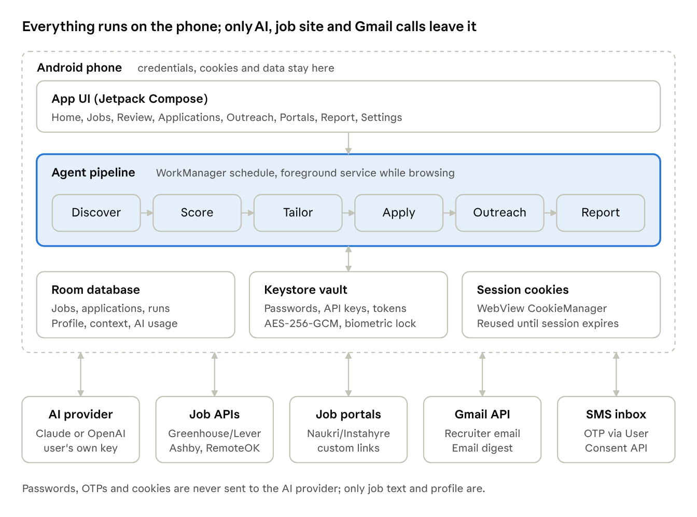

# PRD: AI Job Search Agent (Android) — Phase 1

Nov 16, 2026 · @nitesh

> Engineering detail is in the [Technical Design](TECHNICAL_DESIGN.md). Exported from the [live doc](https://claude.ai/artifact/Sv2XUPALWcvekUmgoAjW5n); edit there and re-export to keep both in sync.

## Overview

Phase 1 ships an Android app that finds, scores and applies to jobs on the user's behalf, using the user's own Claude or ChatGPT API key, with a human approval step before anything is submitted.

**Problem.** Job seekers spend hours a day repeating the same work across Naukri, Instahyre, company career pages and remote boards: searching, reading descriptions, judging fit, filling forms and writing recruiter messages. Most of that effort goes into jobs that turn out to be a poor fit.

**Vision.** A personal job-search agent in your pocket. The user describes what they want once, connects their portals, and the agent does the searching and paperwork daily. The user spends a few minutes approving the best matches and reading a daily report.

### Goals

- Automate discovery, scoring and application across job portals, ATS career pages and remote boards.
- Let the user bring their own AI provider (Anthropic Claude or OpenAI ChatGPT), API key and model.
- Classify every job as High match, Partial match or Low match, with filters for each.
- Let the user add free-form context that shapes search and scoring.
- Let the user add custom portals with login, and auto-fill OTPs from SMS with user consent.
- Deliver a daily report of jobs found, matched, applied and replied.

### Non-goals for Phase 1

- iOS app or web app.
- Fully unattended LinkedIn automation (LinkedIn outreach is assisted, user-sent).
- Bypassing CAPTCHAs or anti-bot protection.
- A hosted multi-user backend; data and credentials stay on the device.

### Success metrics

| Metric | Target (90 days after launch) |
| --- | --- |
| Time spent by user per day on job search | Under 15 minutes |
| Share of High-match jobs the user approves | At least 60% |
| Application success rate (submitted without error) | At least 90% on supported portals |
| Recruiter response rate on applied jobs | Tracked; baseline set in first 30 days |
| Daily report open rate | At least 70% of active days |
| Portal account restrictions caused by the app | Under 2% of active users per quarter |

## Target users and user stories

The primary user is an Indian software professional (2 to 10 years of experience) looking for remote or hybrid roles, active on Naukri and Instahyre, and comfortable creating an AI API key.

| Persona | Situation | What they need most |
| --- | --- | --- |
| Active switcher | Employed, applying in spare time | Daily automation, minimal time per day |
| Remote seeker | Wants global remote roles from India | Strict filtering of "remote, US only" roles |
| Laid-off job seeker | Searching full-time, high volume | Wide coverage, fast follow-ups, tracking |

### User stories

1. As a user, I set up my profile once (resume, skills, preferences) so the agent knows what I want.
2. As a user, I add free-form context like "prefer product companies, no crypto, open to Bengaluru hybrid" and the agent respects it.
3. As a user, I choose Claude or ChatGPT, paste my API key and pick models, so the agent runs on my account.
4. As a user, I add Naukri, Instahyre or any custom portal link with my login, so the agent can search and apply there.
5. As a user, when a portal sends an OTP, the app reads it from SMS (after I allow it) so I don't have to type it.
6. As a user, I see jobs grouped into High and Partial match, with reasons, and filter by either.
7. As a user, I approve or reject jobs in one tap, and approved jobs are applied to automatically.
8. As a user, I get recruiter emails sent from my Gmail and LinkedIn messages drafted for me to send.
9. As a user, I get a daily report of jobs found, matched, applied and replied.
10. As a user, I can switch to auto-apply for High-match jobs on portals I trust, within a daily cap.

## Business requirements

All six business requirements are in Phase 1 scope; each maps to the functional requirements below.

| ID | Business requirement | Delivered by | FR sections |
| --- | --- | --- | --- |
| BR1 | Automate job search from the app | Scheduled agent runs: discover, score, tailor, apply, outreach | FR1, FR3, FR5, FR6, FR7 |
| BR2 | Use Claude or ChatGPT API key and choose models | AI provider settings with per-task model selection | FR10 |
| BR3 | Daily report of jobs applied | In-app report, push notification, optional email digest | FR11 |
| BR4 | High and Partial match filters | Match scoring with three tiers and filter chips | FR4 |
| BR5 | Add more context to the search | Free-form context field and saved search presets | FR2 |
| BR6 | Custom portals with credentials and SMS OTP reading | Portal manager, encrypted credential vault, SMS OTP auto-fill | FR8, FR9 |

## Functional requirements

Twelve requirement areas make up Phase 1; P0 items are required for launch, P1 items ship in Phase 1 but can follow the first internal build.

### FR1. Profile and preferences (P0)

- Upload resume (PDF or DOCX); the app extracts text and asks the AI to pre-fill skills, experience, education and past roles for the user to confirm.
- Preferences: target roles, seniority, skills, minimum salary (CTC in INR, or USD for global roles), notice period, current CTC, expected CTC.
- Work mode: Remote only, Remote or Hybrid, Any. Acceptable locations and time zones.
- Deal-breakers list (industries, company types, keywords).
- Standard answers bank for common portal questions (notice period, CTC, years with a skill, relocation, work authorization). The AI maps new questions to these answers.
- Writing samples (past cover letters or messages) so generated text matches the user's voice.

### FR2. Custom search context (P0)

- A free-form context field (up to 2,000 characters), e.g. "Prefer product startups under 500 people, avoid service companies, open to Bengaluru hybrid."
- Context is passed to both discovery (search keywords) and scoring (fit judgement).
- Saved search presets: name, keywords, portals, context, filters. Multiple presets can run on a schedule.
- Per-run override: the user can add one-off context before triggering a manual run.

### FR3. Job discovery (P0)

- Built-in sources: Greenhouse, Lever and Ashby public job-board APIs (from a company watchlist the user edits), RemoteOK and Remotive APIs, We Work Remotely RSS, Hacker News "Who is hiring" via the Algolia HN API.
- Portal sources: Naukri, Instahyre and user-added portals (FR8).
- Each job is normalized: company, title, location, work mode, salary if listed, description, URL, source, posted date.
- Deduplication by URL and by hash of normalized company plus title.
- Incremental runs: only jobs newer than the last successful run per source are processed.

### FR4. Match scoring and filters (P0)

Every job passes three layers, cheapest first, and ends in one tier.

1. Hard filters (no AI): deal-breakers, seniority, location and work-mode rules, including detection of "remote, US only" or work-authorization requirements.
2. Embedding similarity between profile and description; jobs below a floor are dropped as Low match without an LLM call.
3. LLM scoring with structured JSON output: score 0 to 100, truly remote and open to the user's location (yes, no, unclear), matched skills, missing skills, red flags, one-line reason.

| Tier | Default score | Default action |
| --- | --- | --- |
| High match | 75 to 100 | Shown first; eligible for auto-apply if enabled |
| Partial match | 50 to 74 | Shown in review queue with missing skills highlighted |
| Low match | Below 50 | Hidden by default; viewable under "All" |

- Filter chips on the Jobs screen: High, Partial, All, plus source, work mode, posted date and salary.
- The user can change both thresholds in Settings.
- Each job card shows the score, tier, matched and missing skills, and the AI's reason.
- Approve and reject decisions are logged and fed back into scoring prompts as examples (feedback loop).

### FR5. Tailored materials (P0)

- For each approved job: cover letter, answers to portal questions, recruiter email draft and LinkedIn message draft.
- The AI must not invent experience; it may only use facts from the profile. Unknown answers are flagged for the user.
- The user can edit any draft before it is used.

### FR6. Applying (P0)

- Review queue: approve, reject or edit each job. Bulk approve for High match.
- On approve, the agent opens the portal in an in-app automated browser, fills the form and submits.
- Default mode is "stop before submit": the agent fills everything and the user taps Submit. Optional "auto-submit High match" mode per portal.
- Daily apply cap per portal (default 10) and overall (default 25).
- Supported apply flows: Naukri direct apply with questionnaire, Instahyre "Interested", Greenhouse and Lever forms. Redirects to Workday or unsupported sites go to an "Apply manually" list with the prefilled answers ready to copy.
- A screenshot of the final page is saved as proof of each submission.
- On any unknown question, CAPTCHA or error, the run pauses that job and notifies the user.
- Apply steps run in a visible "Agent at work" screen with a live view of the portal and a Stop button. Android WebViews are unreliable when the app is fully in the background, so scheduled runs discover, score and tailor in the background, then notify the user to open the app and tap "Apply approved".

### FR7. Recruiter outreach (P1)

- Email: if the posting lists a recruiter email, send the tailored email through the user's Gmail (Google sign-in, Gmail API). Cap of 10 emails per day. Every email is shown for approval unless the user enables auto-send.
- LinkedIn: assisted only. The app shows the drafted message and a button that opens the recruiter's profile or the LinkedIn app; the user pastes and sends. No automated LinkedIn actions.
- Follow-up reminder after 7 days with no reply, with a drafted follow-up.

### FR8. Portal manager (P0)

- Built-in portal templates: Naukri, Instahyre. Users can add custom portals with a name, login URL and search URL.
- For each portal: username, password, login method (password or OTP), enabled toggle, daily caps, search keywords.
- "Test connection" button that runs a login and reports success, OTP needed or failure.
- Session reuse: after first login, cookies are stored so later runs skip login until the session expires.
- Custom portals without a built-in adapter use the generic AI browser agent (see Architecture), marked "Beta" in the UI.

### FR9. OTP auto-read from SMS (P0)

- When a portal login asks for an OTP, the app listens for the next incoming SMS using Google's SMS User Consent API. Android shows a one-time consent prompt for that message; on approval, the app extracts the OTP (4 to 8 digits) and fills it.
- The app does not request the broad READ\_SMS permission, which Google Play restricts for apps that are not the default SMS app.
- If a run is in the background, the app posts a notification "Naukri needs an OTP"; tapping it opens the app and starts the consent listener.
- Timeout after 5 minutes; the job is retried at the next run.
- Email-based OTPs (P1): read from Gmail if the user connected it. This needs the gmail.readonly scope, which Google classifies as restricted and which requires an annual third-party security assessment before public release; until then, a notification lets the user paste the code.

### FR10. AI provider and model selection (P0)

- Provider choice: Anthropic (Claude) or OpenAI (ChatGPT). Both can be configured; one is active.
- API key entry with "Validate key" (a minimal test request).
- Model picker per task, populated live from the provider's models endpoint so new models appear without an app update:
  - Classification and scoring: a small, fast model by default (e.g. a Claude Haiku-class model).
  - Writing (cover letters, emails): a stronger model (e.g. a Claude Sonnet-class model).
  - Browser agent (generic portals): the strongest model the user is willing to pay for.
- Embeddings: OpenAI embeddings if an OpenAI key is present; otherwise an on-device embedding model.
- Usage meter: tokens and estimated cost per day and per run, with a monthly budget cap that pauses the agent when reached. Prices come from a remotely updated price table the user can edit, because provider model lists do not include pricing.

### FR11. Daily report (P0)

- Generated at a user-chosen time (default 9:00 PM IST) and delivered as a push notification and an in-app report; optional email digest.
- Contents: jobs discovered, High and Partial counts, approved, applied (by portal), emails sent, LinkedIn drafts pending, replies received, failures needing attention, AI cost today.
- History view with a 30-day chart of applications and replies.

### FR12. Tracking and scheduling (P0)

- Status per job: Found, Scored, Approved, Applied, Replied, Interview, Offer, Rejected, Skipped, Failed. User can update status manually.
- Scheduled runs (every 3, 6 or 12 hours, or manual), only on Wi-Fi or any network, only while charging (optional).
- Run log with per-step results and errors.

## User flows and screens

The app has five bottom-nav tabs (Home, Jobs, Review, Portals, Settings) and two core flows: a one-time onboarding and a daily review loop.

### Onboarding (target: under 10 minutes)

1. Welcome and consent: what the agent does, what data stays on device, portal terms-of-service notice.
2. Upload resume; confirm the AI-extracted profile.
3. Set preferences, deal-breakers and free-form context.
4. Choose AI provider, paste API key, validate, pick models (sensible defaults pre-selected).
5. Add portals: Naukri, Instahyre or custom; enter credentials; run "Test connection" (OTP consent prompt appears here the first time).
6. Optional: connect Gmail for outreach and email digest.
7. Choose schedule and daily caps; run the first search now.

### Daily loop

1. Scheduled run discovers and scores jobs in the background.
2. Notification: "14 new High matches, 22 Partial."
3. User opens Review, swipes or taps to approve or reject, edits drafts if needed.
4. Agent applies to approved jobs; OTP or unknown-question prompts appear as notifications.
5. User sends any LinkedIn drafts with one tap each.
6. Evening daily report summarizes the day.

### Screens

| Screen | Purpose | Key elements |
| --- | --- | --- |
| Home | Today at a glance | Counts by status, next run time, Run now, items needing attention, AI cost today |
| Jobs | Browse everything found | Filter chips (High, Partial, All, source, mode, date), search, job cards with score |
| Job detail | Decide on one job | Description, score breakdown, matched and missing skills, drafts, Approve, Reject, Open in portal |
| Review | Fast approval queue | Swipe cards, bulk approve High, edit drafts |
| Applications | Track outcomes | Status pipeline, proof screenshots, follow-up reminders |
| Outreach | Emails and LinkedIn drafts | Pending, sent, replied; copy and open LinkedIn buttons |
| Portals | Manage logins | Portal list, add custom portal, credentials, test connection, caps |
| Report | Daily and history | Today's report, 30-day chart, export CSV |
| Settings | Configuration | Profile, context and presets, AI provider and models, budget, thresholds, schedule, notifications, data and privacy |

## Architecture and tech stack

The app is fully on-device: a native Kotlin app runs the agent pipeline on a schedule, drives portals in an embedded WebView, and calls only the user's chosen AI provider, job APIs, portals and Gmail.

The pipeline reads and writes the three local stores; every external call starts from the pipeline, and the SMS link is read-only and consent-gated.

### Tech stack

| Layer | Choice | Notes |
| --- | --- | --- |
| UI | Kotlin, Jetpack Compose, Material 3 | Mobile-first, dark and light themes |
| App architecture | MVVM, Hilt, coroutines and Flow | Single-activity app |
| Local data | Room (SQLite) | All job, application and report data |
| Secrets | Android Keystore with AES-GCM (e.g. Google Tink) | Passwords, API keys, OAuth tokens |
| Scheduling | WorkManager, foreground service during browser automation | Network and charging constraints |
| Networking | OkHttp, Retrofit, kotlinx.serialization | REST calls to AI and job APIs |
| AI layer | Provider interface with Anthropic and OpenAI implementations | Structured JSON output, retries, cost tracking |
| Embeddings | OpenAI embeddings or an on-device text embedder (TensorFlow Lite or MediaPipe) | Cheap pre-filter before LLM scoring |
| Browser automation | Android WebView with injected JavaScript | Playwright does not run on Android; adapters are JS scripts |
| Portal adapters | Per-portal scripts (Naukri, Instahyre, Greenhouse, Lever) loaded via remote config | Updated without an app release |
| Generic portal agent | LLM reads a simplified DOM and returns the next action (click, type, wait) | Beta, for custom links |
| OTP | SMS User Consent API (Google Play services) | No READ\_SMS permission |
| Email | Google Sign-In with Gmail API | Send scope; read scope only for email OTP |
| Resume parsing | On-device PDF and DOCX text extraction, AI structuring | User confirms extracted fields |
| Charts | Compose chart library (e.g. Vico) | Report history |

### Portal adapter contract

Every portal implements the same five operations so the pipeline treats them alike: `login()` returns logged-in, OTP-needed or failed; `search(preset)` returns job summaries; `getDetails(url)` returns a normalized job; `apply(job, answers, mode)` returns submitted, ready-for-user, needs-input or failed; `healthCheck()` verifies selectors still work.

### Data model

| Entity | Key fields |
| --- | --- |
| Profile | Resume text, skills, experience, preferences, deal-breakers, answers bank, writing samples |
| SearchPreset | Name, keywords, portals, context, filters, schedule |
| Portal | Name, type (built-in or custom), login URL, search URL, caps, enabled, last session status |
| Credential | Portal ID, encrypted username and password (vault only) |
| Job | Source, external ID, company, title, location, work mode, salary, description, URL, posted date, dedupe hash |
| MatchResult | Job ID, score, tier, matched skills, missing skills, red flags, reason, model used |
| Application | Job ID, status, mode (auto or reviewed), submitted at, proof screenshot, answers used |
| OutreachMessage | Job ID, channel (email or LinkedIn), recipient, draft, status, sent at, replied at |
| Run | Start and end time, preset, counts per step, errors |
| UsageRecord | Run ID, provider, model, input and output tokens, estimated cost |
| DailyReport | Date, counts by status and portal, replies, failures, cost |
| CompanyWatchlist | Company name, ATS type (Greenhouse, Lever or Ashby), board slug, enabled |

## Non-functional requirements

Security carries the most weight in Phase 1, because the app holds portal passwords, session cookies and paid API keys.

### Security and privacy

- Portal passwords, API keys and Gmail tokens are encrypted with AES-256-GCM using keys held in the Android Keystore (hardware-backed where available). Nothing sensitive is stored in plain SharedPreferences.
- Optional biometric or device-PIN lock to open the app and to view credentials.
- Credentials and session cookies never leave the device, except when sent to the portal itself during login.
- Only job descriptions and profile text are sent to the chosen AI provider; passwords, OTPs and cookies are never included in prompts.
- OTPs are used once and discarded, never stored or logged.
- Logs and screenshots are redacted of credentials; screenshots stay in app-private storage.
- Exclude credential and cookie stores from Android cloud backup.
- "Delete all data" wipes the database, vault, cookies and screenshots in one action.
- Privacy policy and in-app disclosure for SMS consent, Gmail scopes and AI data sharing, as required by Google Play.
- Comply with India's Digital Personal Data Protection Act, 2023: consent notice at onboarding, data used only for the job search, and deletion on request.

### Performance and battery

- A scheduled run of 200 discovered jobs completes in under 15 minutes on Wi-Fi.
- Hard filters and embeddings remove at least 70% of jobs before any LLM call.
- Background runs use WorkManager with constraints; browser automation runs in a foreground service with a visible progress notification, declared with the foreground service type that Android 14 and above require.
- Battery use under 5% per day with a 6-hour schedule.

### Reliability

- Each job step is idempotent; a crashed run resumes without double-applying.
- A job is never submitted twice: submission is recorded before and confirmed after.
- Adapter failures (selector not found, layout change) are logged with a screenshot and surfaced on Home; other portals keep running.
- AI calls retry with backoff on rate limits; budget cap is enforced before each call.

### Compatibility and accessibility

- Android 10 (API 29) and above; phones first, tablet layouts adapt.
- Dark and light themes, TalkBack labels, minimum 48dp touch targets.
- English UI in Phase 1.

## Compliance and risks

The biggest risk is portal accounts being restricted for automated use; the product is designed around low volume, human approval and no anti-bot evasion.

| Risk | Likelihood | Impact | Mitigation |
| --- | --- | --- | --- |
| Naukri, Instahyre or other portals restrict accounts for automation (their terms generally prohibit bots) | High | High | Default stop-before-submit, daily caps, session reuse instead of repeated logins, clear ToS notice at onboarding, user accepts risk per portal |
| Portal layout changes break adapters | High | Medium | Stable selectors, adapter versioning with remote config updates, AI browser agent fallback, failure alerts |
| Google Play rejects SMS or Gmail access | Medium | High | SMS User Consent API instead of READ\_SMS; minimal Gmail scopes (gmail.send by default; gmail.readonly for email OTP is a restricted scope needing an annual security assessment); clear disclosures |
| Google Play rejects the app for collecting third-party portal credentials or automating other websites | Medium | High | Credentials used only on their own portal and kept on device, prominent disclosure, Play policy review before submission; fallback distribution as a signed APK or closed testing track |
| LinkedIn account restrictions | Medium | High | No LinkedIn automation; drafts only, user sends |
| CAPTCHAs block applications | Medium | Medium | Never bypass; pause the job and hand it to the user |
| Low-quality or false information in applications | Medium | High | Facts only from profile, unknown answers flagged, user review by default |
| Unexpected AI costs | Medium | Medium | Cheap-first filtering, per-task models, budget cap and usage meter |
| Credential leak from the device | Low | High | Keystore encryption, biometric lock, no cloud backup of secrets, no credentials in prompts or logs |
| Recruiter email marked as spam | Medium | Medium | Daily cap, personalization, approval by default, opt-out line |
| Android background limits stop runs | Medium | Medium | WorkManager constraints, foreground service during automation, "run now" fallback, apply steps run in the visible Agent at work screen |

## Phase 1 delivery plan

All features ship together in Phase 1, built in five milestones over an estimated 14 weeks for two Android developers; the estimate is a planning assumption to confirm with the team.

1. Weeks 1 to 3, foundation: profile and resume parsing, AI provider and model settings, Room database, Keystore vault, app shell.
2. Weeks 4 to 6, discovery and scoring: job APIs, deduplication, hard filters, embeddings, LLM scoring, Jobs and Review screens.
3. Weeks 7 to 10, portals and applying: portal manager, Naukri and Instahyre adapters, session reuse, SMS OTP, Greenhouse and Lever forms, Agent at work screen.
4. Weeks 11 to 12, outreach and reporting: Gmail send, LinkedIn drafts, follow-ups, daily report, usage meter, scheduling.
5. Weeks 13 to 14, hardening and beta: security review, Play policy review, adapter health checks, closed beta with 20 users.

## Acceptance criteria and open questions

Phase 1 is done when every business requirement passes its acceptance test below on a real device.

| BR | Acceptance test |
| --- | --- |
| BR1 | A scheduled run with no user action discovers, scores and queues jobs from at least 3 sources; approved jobs on Naukri and Greenhouse are applied end to end |
| BR2 | User can switch between Claude and ChatGPT, validate a key, pick models per task from a live list, and see per-run cost |
| BR3 | Daily report arrives at the set time with correct counts matching the Applications screen |
| BR4 | High and Partial chips filter correctly; changing thresholds re-tiers existing jobs |
| BR5 | Adding context such as "no service companies" measurably changes results in a test set |
| BR6 | User adds a custom portal with credentials; an OTP login completes using the SMS consent prompt without typing |

### Analytics (on-device, opt-in for anonymous telemetry)

Run success rate per portal, adapter failure reasons, approval rate by tier, apply success rate, reply rate by source, AI cost per applied job.

### Open questions

- [ ] Should a lightweight cloud runner be offered later for users whose phones kill background work, given credentials would then leave the device?
- [ ] Which custom portals beyond Naukri and Instahyre get dedicated adapters first (e.g. Wellfound, Cutshort, Hirist, Indeed India)?
- [ ] Is auto-submit for High match allowed at launch, or only after a user has approved 20 jobs manually?
- [ ] Free app with BYO key only, or a paid tier with bundled AI credits?
- [ ] Should the generic AI browser agent ever submit applications, or only fill forms for user review?
