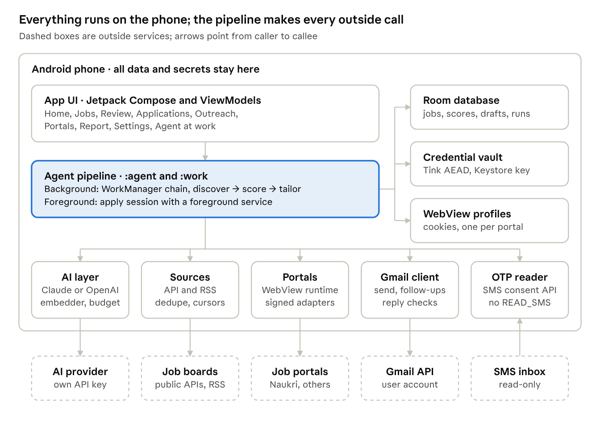
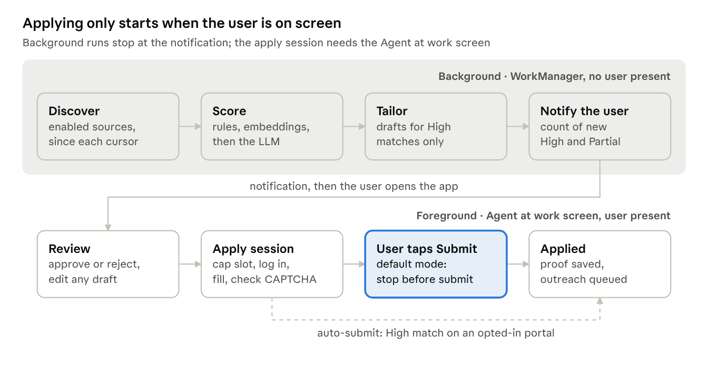
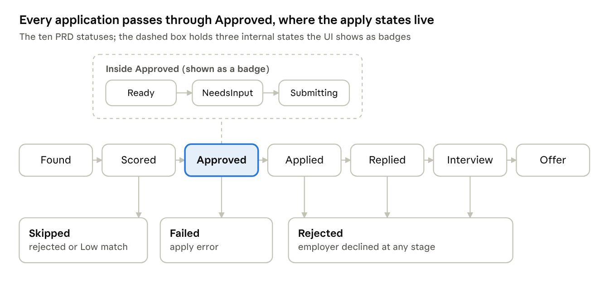

# AI Job Search Agent — Technical Design (Phase 1)

Nov 16, 2026 · @nitesh

> Companion to the [Phase 1 PRD](PRD.md); the task breakdown is in [TASK.md](../TASK.md). This file is the source of truth; edit it here.

Phase 1 ships as a single Android app in Kotlin and Jetpack Compose. A WorkManager pipeline discovers, scores and tailors jobs in the background; applying runs in a visible WebView session only after the user approves. Everything is stored on the phone, and only calls to the user's AI provider, job sites and Gmail leave it.

## Scope and constraints

Phase 1 builds the six PRD stages (discover, score, tailor, apply, outreach, report) for one user on one phone, with no backend server. The constraints below drive most design choices in this document.

| Constraint | Value | What it forces in the design |
| --- | --- | --- |
| Minimum Android | Android 10 (API 29) | Scoped storage, `dataExtractionRules` only from API 31, so both backup configs ship |
| Target SDK | API 36 (Android 16) | Typed foreground services, runtime notification permission, exact-alarm limits |
| AI access | User's own Anthropic or OpenAI key | No app-owned key or proxy; cost is metered per user and shown in the app |
| Data location | Everything on the device | Room for data, Keystore-wrapped keys for secrets, no analytics or crash backend by default |
| Network egress | AI provider, job sources and portals, Google APIs | A single allowlisted `OkHttpClient` per destination group; cleartext disabled |
| Market | India first | IST default schedule, Naukri and Instahyre adapters first, DPDP Act 2023 compliance |
| Applying | User approval by default | Background work stops at "ready to apply"; submission happens in a visible session |

**Non-goals for Phase 1:** a server, accounts or sync between devices; any LinkedIn automation beyond drafts; solving CAPTCHAs or evading bot checks; an iOS or web client; multiple user profiles on one install.

## Architecture

Three layers run on the phone: the Compose UI, the agent pipeline, and the service modules the pipeline drives, all over three local stores. Only the service modules talk to the outside world.



The UI reads Room through the same repositories the pipeline uses. A static config host also serves signed adapter scripts and the model price table; it receives no user data.

## Modules

The app is split into Gradle modules along the README's package layout, so the pipeline, AI layer and portal runtime compile and test without UI. Dependencies point downward only: features depend on domain modules, never on each other.

| Module | Responsibility | Depends on |
| --- | --- | --- |
| `:app` | Application class, single Activity, navigation graph, Hilt wiring | All `:feature:*`, `:work` |
| `:feature:*` (onboarding, home, jobs, review, applications, outreach, portals, report, settings) | Compose screens and ViewModels, one module per screen group | `:core:ui`, `:agent`, `:core:data` |
| `:core:ui` | Material 3 theme, shared components, Vico chart wrappers | — |
| `:core:model` | Pure Kotlin domain types (`Job`, `Profile`, `MatchResult`, enums) | — |
| `:core:data` | Room database, DAOs, repositories, migrations, DataStore settings | `:core:model` |
| `:core:security` | Credential vault, key management, biometric gate, log and prompt redaction | `:core:model` |
| `:core:network` | OkHttp clients per destination group, retry and backoff, JSON config | `:core:model` |
| `:core:config` | Fetches and verifies signed adapter scripts and the model price table from the static config host | `:core:network`, `:core:security` |
| `:ai` | `LlmProvider` and `Embedder` interfaces, Anthropic and OpenAI clients, prompt templates, output schemas, usage metering, prompt guard | `:core:network`, `:core:security`, `:core:model` |
| `:sources` | Job-board API clients, normalizer, deduplicator | `:core:network`, `:core:model` |
| `:portals` | WebView runtime, JS bridge, `PortalAdapter` implementations, generic browser agent | `:ai`, `:core:security`, `:core:config` |
| `:otp` | SMS User Consent listener and OTP extraction | `:core:model` |
| `:email` | Google authorization, Gmail send, reply checks | `:core:network`, `:core:security` |
| `:agent` | Pipeline orchestrator, stage use cases, caps policy, budget guard | `:ai`, `:sources`, `:portals`, `:email`, `:otp`, `:core:data` |
| `:work` | WorkManager workers, schedules, apply foreground service, notifications | `:agent` |

Versions live in one Gradle version catalog (`gradle/libs.versions.toml`), and shared build logic sits in convention plugins under `build-logic/`. Each module's build file only applies a convention plugin and lists its dependencies; namespaces are derived from the Gradle path (`:core:data` becomes `com.coderarchitech.jobassistant.core.data`).

| Convention plugin | Applies to | What it sets up |
| --- | --- | --- |
| `jobassistant.android.application` | `:app` | SDK levels, Java 17 bytecode, strict Android Lint, detekt, ktlint |
| `jobassistant.android.library` | Android modules | The same, plus the `unitTest` and `staticChecks` aggregate tasks |
| `jobassistant.android.compose` | Modules with UI | Compose compiler, Compose BOM, Material 3 |
| `jobassistant.android.hilt` | Modules with injection | Hilt with KSP |
| `jobassistant.android.feature` | `:feature:*` | Library, Compose, Hilt, ViewModel libraries; fails the build if a feature module depends on another |
| `jobassistant.jvm.library` | `:core:model` | Kotlin JVM only, so Android imports cannot compile there |
| `jobassistant.static.analysis` | Every module | detekt (`config/detekt/detekt.yml`) and ktlint (`.editorconfig`) |

**Toolchain** (upgrade together and update this table):

| Item | Version or value |
| --- | --- |
| Gradle (wrapper, checksum pinned) | 9.8.2 |
| Android Gradle Plugin | 9.5.0, with its built-in Kotlin support |
| Kotlin / KSP | 2.4.20 / 2.3.13 |
| Hilt / Compose BOM | 2.60.1 / 2026.09.00 |
| kotlinx.serialization | 1.12.0 (plugin version follows Kotlin) |
| JDK to build / bytecode target | 21 / Java 17 |
| `minSdk` / `targetSdk` / `compileSdk` | 29 / 36 / 37 |
| Application ID | `com.coderarchitech.jobassistant` (`.dev` suffix for the dev flavor) |

`compileSdk` is 37 because the newest AndroidX libraries require it; `targetSdk` stays at 36, the Play requirement this design targets, so runtime behavior is unchanged. The application ID cannot change after the first Play upload, so confirm it before T0.07.

**Build variants.** Flavors `dev` and `prod` × build types `debug` and `release`. `dev` adds the `.dev` package suffix, the `-dev` version suffix and the launcher label "Job Assistant Dev", so both install side by side and can be told apart; `scripts/ci/flavors_side_by_side_check.sh` installs both debug builds on the API 34 emulator in CI, checks both packages are present and that both run at once (task T0.06). Release builds run R8 with resource shrinking. `BuildConfig.CONFIG_HOST` comes from `gradle.properties` per flavor (empty until T3.10), and `BuildConfig.HTTP_LOGGING` is true only in debug.

## Agent pipeline and scheduling

The pipeline is a chain of idempotent stages over Room state: each stage picks up jobs in its input status and moves them to the next one in a single transaction. A run that is killed resumes where it stopped, and nothing is ever applied twice.



The tinted row runs unattended; the lower row needs the user on screen, and auto-submit only skips the Submit tap.

| Stage | Runs in | Status change | Work | Guard checked first |
| --- | --- | --- | --- | --- |
| Discover | `DiscoverWorker` (background) | → Found | Fetch each enabled source since its cursor, normalize, deduplicate | None (no AI calls) |
| Score | `ScoreWorker`, batches of 25 jobs | Found → Scored | Hard filters, embedding floor, LLM score for survivors | Monthly budget |
| Tailor | `TailorWorker` | Approved → Ready (a High-match job's drafts are written while it is still Scored) | Cover letter, form answers, email and LinkedIn drafts | Monthly budget |
| Apply | `ApplySession` in the Agent at work screen plus a foreground service | Approved → Applied, NeedsInput or Failed | Log in, fill the form, stop before submit or submit, save proof | Daily caps per portal and overall |
| Outreach | `OutreachWorker` | Applied → email sent | Send approved emails, create 7-day follow-ups | 10 emails per day |
| Report | `ReportWorker`, daily at the chosen time | — | Aggregate counts and cost, notify, optional digest | None |

**Eager and lazy tailoring.** High-match jobs are tailored in the background so drafts are ready in Review. Partial-match jobs are tailored only after approval, which keeps writing-model spend proportional to what the user actually wants. Writing drafts never changes a job's status: a High-match job stays Scored until the user approves it, so Approved always means the user approved it (D13).

**Scheduling rules**

- Each search preset owns one `PeriodicWorkRequest` (every 3, 6 or 12 hours) under the unique name `run:<presetId>`, updated with `ExistingPeriodicWorkPolicy.UPDATE` when settings change.
- Each tick enqueues a unique one-time chain `Discover → Score → Tailor → Notify` with `ExistingWorkPolicy.KEEP`, so two runs of the same preset never overlap.
- Constraints come from settings: network (any or unmetered), optional charging, and battery-not-low always.
- A WorkManager worker has a 10-minute execution window, so scoring and tailoring process fixed batches and re-enqueue themselves until their input queue is empty. This meets the PRD target of 200 jobs in under 15 minutes without a long-running foreground worker.
- The daily report is a one-time request with an initial delay to the chosen time, re-enqueued after each run. It does not use exact alarms, so it can drift by up to about 15 minutes.
- "Run now" enqueues the same chain as an expedited request.

**Applying never runs unattended.** Background runs end by notifying the user ("14 new High matches"). Applying starts only when the user taps **Apply approved**, which opens the Agent at work screen and starts a foreground service so the process keeps its priority during each step. If the user leaves the screen, the session finishes the current step, pauses and posts a notification.

**No double submission.** Before clicking submit, the session writes the application as `SUBMITTING` with an attempt ID. It writes `SUBMITTED` only after the portal's confirmation appears. A record still in `SUBMITTING` after a crash is never retried automatically; it moves to a "Check manually" list. Every write that settles a live attempt carries its attempt ID, so a stale session cannot confirm or fail a newer one (see **Status transitions**).

## Data model

One Room database (`agent.db`, schema exported and versioned) holds all non-secret state. Secrets never enter Room: the PRD's `Credential` entity lives in the vault and rows refer to it by a vault key such as `portal/<id>`.

| Entity | Key fields | Constraints and notes |
| --- | --- | --- |
| `Profile` | resumeText, skills, experience, preferences, dealBreakers, answersBank, writingSamples, `version` | Single row; `version` increments on every edit and keys the score cache |
| `SearchPreset` | name, keywords, portalIds, context (≤ 2,000 chars), filters, schedule | Each preset owns one periodic work request |
| `CompanyWatchlist` | name, atsType (Greenhouse, Lever, Ashby), boardSlug, enabled | Unique on (atsType, boardSlug) |
| `Portal` | name, type (built-in or custom), adapterId, loginUrl, searchUrl, caps, enabled, autoSubmitHigh, lastSessionStatus | Credentials in the vault under `portal/<id>` |
| `Job` | source, externalId, company, title, location, workMode, salary, description, url, canonicalUrl, postedAt, dedupeHash, status | Unique on (source, externalId); indexed on dedupeHash and status |
| `MatchResult` | jobId, profileVersion, score, remoteEligible, matchedSkills, missingSkills, redFlags, reason, decidedBy (filter, embedding or LLM), model | Tier is computed from score and current thresholds, never stored, so changing a threshold re-tiers instantly |
| `Draft` | jobId, kind (cover letter, answers, email, LinkedIn), content, unknownFields, editedByUser | New; holds FR5 output |
| `Decision` | jobId, approve or reject, optional reason, decidedAt | New; the latest decisions feed scoring prompts as examples |
| `Application` | jobId, portalId, status, mode (auto or reviewed), attemptId, submittingAt, submittedAt, proofPath, answersUsed | Unique on jobId, which enforces one application per job |
| `OutreachMessage` | jobId, channel, recipient, draft, status, gmailThreadId, sentAt, repliedAt, followUpDueAt |  |
| `Run` | presetId, startedAt, endedAt, status, countsPerStage, errors | Source of the run log |
| `SourceCursor` | sourceKey, lastSuccessAt, lastSeenExternalId | New; makes discovery incremental per source |
| `UsageRecord` | runId, provider, model, task, inputTokens, outputTokens, cachedTokens, cacheWriteTokens, estimatedCost | One row per AI call; `cachedTokens` counts cache reads |
| `CapUsage` | day, scope (`overall` or `portal/<id>`), used | Slots taken per local day for the apply caps; not a `:core:model` type |
| `DailyReport` | date, countsByStatus, countsByPortal, replies, failures, cost | Written by `ReportWorker` from the same queries the Applications screen uses |

Lists such as skills are stored as JSON columns through kotlinx.serialization type converters. Settings that are not records (thresholds, schedule, selected models) live in Proto DataStore; see **Settings** below.

**Domain types** (`:core:model`, task T1.02). Every entity above has a plain Kotlin type in `com.coderarchitech.jobassistant.core.model`, with no Android dependency; Room entities in `:core:data` map to and from them. Conventions:

- **Validation in the type.** Constructors reject impossible values with `require`: a score outside 0–100, a reason over 140 characters, preset context over 2,000 characters, a salary with no bounds or `min > max`, a negative cap or token count, a built-in portal without an adapter, an LLM score without a model.
- **Tier is computed, not stored.** `TierThresholds(high = 75, partial = 50).tierFor(score)` gives the tier, so changing thresholds re-tiers stored scores without AI calls.
- **Statuses.** `JobStatus` holds the ten PRD statuses plus `READY`, `NEEDS_INPUT` and `SUBMITTING`, which are internal and show as `APPROVED` (`userFacing`). `ApplicationStatus` adds `CHECK_MANUALLY` for an attempt left in `SUBMITTING` after a crash, and `APPLY_MANUALLY` for redirects to unsupported sites. The allowed moves are in `JobTransitions` and `ApplicationTransitions` (see **Status transitions**).
- **Units.** Times are `java.time.Instant`, dates `LocalDate`, salaries whole currency units with an ISO 4217 code and a period, and AI cost micro-US-dollars (`1_000_000` = $1) so sums stay exact.
- **JSON columns.** Value types stored as JSON (`Skill`, `Role`, `Education`, `Preferences`, `DealBreakers`, `StandardAnswer`, `Salary`, `JobFilters`, `RunSchedule`, `RunError`) are `@Serializable`; new fields get defaults so older rows still decode. `YearMonth` is stored as `"YYYY-MM"`.
- **No secrets.** No type has a field for a password, token, cookie or OTP; `Portal.vaultKey` (`portal/<id>`) names the vault slot instead.
- `AiProvider`, `AiTask` and `UsageRecord` live here because usage rows are data; the request and response types stay in `:ai`.

**Settings** (`:core:data`, task T1.06). App-wide settings are one `AppSettings` value (`:core:model`), stored in the Proto DataStore file `files/datastore/settings.pb` (schema `core/data/src/main/proto/settings.proto`) and read through `SettingsRepository` (`settings: Flow<AppSettings>`, `update(transform)`, `reset()`).

| Group | Fields and defaults | Source |
| --- | --- | --- |
| Thresholds | High 75, Partial 50 | PRD |
| Default schedule | Every 6 hours, any network, not charging-only; copied into each new preset | Design |
| Report time | 21:00 in the device time zone | PRD |
| Caps | 25 applies a day overall, 10 per new portal, 10 emails a day | PRD |
| Budget | $10 a month; generic browser agent $0 a day, so it stays off until the user gives it a budget | Chosen in T1.06 |
| AI | Provider (unset until onboarding), model override per task (none: use the remote-config default) | PRD FR10 |
| Toggles | Auto-send emails off, email digest off. Auto-send is stored only on the device (see **Backups**) | PRD |

Rules for reading and changing the file:

- The app always writes a complete message, with every scalar `optional` so a missing field is told apart from a real 0 or `false`. A missing field takes its default, so adding a setting needs no migration. `schema_version` (now 1) is reserved for a change that "missing means default" cannot express.
- Enums are stored by constant name, so those names are a storage format: `StoredEnumNamesTest` fails if one is renamed. An unknown name falls back to the default; an override for an unknown task is dropped.
- Caps and budget are checked field by field: one negative value resets only that field and never undoes a lower limit set elsewhere. Thresholds are checked as a pair. A model override must look like a model id; text shaped like an API key (`sk-...`) is rejected, so a key pasted in the wrong field is never stored outside the vault.
- A corrupt file is replaced with the defaults. A read that keeps failing with an I/O error is retried three times (100, 200, 400 ms) and then fails the flow instead of inventing values, so the budget guard and caps can fail closed.
- No secrets: the API key is in the vault; `settings.pb` holds only the provider name and model ids.

**Room database** (`:core:data`, task T1.03). `AgentDatabase` (`agent.db`, version 3) has one table per entity above, named in snake case (`job`, `match_result`, `outreach_message` and so on). Each table has an entity class, `toEntity()` and `toModel()` mappers to the pure `:core:model` type, and a DAO under `core.data.db`. The schema for every version is exported to `core/data/schemas/` and committed; the Room Gradle plugin writes it. Rules the code follows:

- **No destructive migration.** The builder never calls `fallbackToDestructiveMigration`, so a missing migration fails loudly instead of wiping the user's history. Migrations live in `AgentMigrations.ALL`, which the builder and the tests share. `MigrationTest` (Robolectric, so it runs on every push) builds each earlier version from its exported schema with `MigrationTestHelper` and checks Room accepts the migrated result. `scripts/ci/check_migration_tests.py` fails CI if the newest exported schema differs from `AgentDatabase.VERSION`, if versions have gaps, or if a version `M` has no `migrateNToM` test.
- **Column choices.**
  - Times are epoch milliseconds, so sub-millisecond precision is dropped; compare timestamps only after truncating to milliseconds, and key guards on status or attempt ID, never on a timestamp.
  - Dates are ISO text, enums are stored by constant name, and lists, maps and value types are JSON through one `Converters` object (unknown JSON keys are ignored and new fields have defaults).
  - `Job.salary` is flattened into `salaryMin`, `salaryMax`, `salaryCurrency` and `salaryPeriod` so the Jobs screen can filter on it in SQL.
  - `DailyReport.countsByStatus` is keyed by `JobStatus` constant name.
  - `Profile` is one row with `id = 1`.
- **Keys and constraints.**
  - `Job` is unique on (source, externalId) and indexed on `dedupeHash`, `canonicalUrl` and `status`; `insert` returns -1 for a duplicate.
  - `Application` is unique on `jobId`.
  - `Draft` is unique on (`jobId`, `kind`).
  - `CompanyWatchlist` is unique on (`atsType`, `boardSlug`).
  - `MatchResult` is keyed on (`jobId`, `profileVersion`); T2.17 adds the context hash and model to the key when it builds the score cache.
- **Foreign keys.**
  - Drafts, decisions, match results and outreach messages are deleted with their job.
  - A job that has an application cannot be deleted (`RESTRICT`), so a `SUBMITTED` record is never lost and the job cannot be applied to a second time after it is found again.
  - A deleted portal, preset or run leaves its applications, runs and usage rows in place with the link cleared.
- **Status changes are not in the DAOs.** `Job`, `Application`, `OutreachMessage` and `Run` have insert and read methods but no `@Update`; `JobDao` and `ApplicationDao` add only a guarded compare-and-set, called by the repositories (see **Status transitions**). `OutreachMessage` and `Run` get theirs with the features that use them (T4.03, T4.05 and T2.20). A draft is never overwritten either: `regenerate` skips a draft the user edited.
- **No secrets.** No column holds a password, token, cookie or OTP; `SchemaGuardsTest` fails if one is named like a secret. A test also pins the stored enum names.



The PRD's ten user-visible statuses stay as they are. The pipeline adds three internal states that the UI groups under them: `Ready` (tailored, shown as Approved), `NeedsInput` and `Submitting` (both shown as Approved with a badge).

**Status transitions** (`:core:model` and `:core:data`, task T1.05). `JobTransitions` and `ApplicationTransitions` hold the allowed moves, and `JobRepository` and `ApplicationRepository` are the only code that changes a status. Each call checks the move against the table, then runs one `UPDATE … WHERE status = :from` in a transaction, so two writers can never both succeed. The result is a `TransitionResult`: `Moved`, `NotAllowed`, `Conflict` (with the status the record actually has), `NotFound`, or `AttemptMismatch`.

| From | Pipeline may move it to |
| --- | --- |
| Found | Scored, Failed (scoring output still invalid after one retry) |
| Scored | Approved, Skipped |
| Approved | Ready, Failed |
| Ready | NeedsInput, Submitting, Failed |
| NeedsInput | Ready, Submitting, Failed |
| Submitting | Applied, Failed |
| Applied | Replied, Rejected |
| Replied | Interview, Rejected |
| Interview | Offer, Rejected |
| Offer, Rejected, Skipped, Failed | none |

- **Manual changes** (PRD FR12): `transitionManually` lets the user set any status the UI shows, other than the current one, but never an internal one. From `Submitting` it allows only Applied or Failed, so a job cannot be re-approved while a click is in flight. A stale screen still gets `Conflict`.
- **Applications.** A live attempt is settled with `markSubmitted`, `markFailed` or `markCheckManually`, each taking the attempt ID. The user settles a record that is no longer in flight with `confirmSubmittedManually` or `markFailedManually`, which refuse `SUBMITTING`. A failed application is final in Phase 1: it is not retried.
- **Crash recovery.** `recoverInterruptedSubmissions()` moves every application left in `SUBMITTING` to `CHECK_MANUALLY`. Call it once at process start, before any apply session can begin, because it cannot tell a crashed attempt from a live one. The matching jobs stay `Submitting` until the user settles them.
- **Several writes at once.** `TransactionRunner.run { … }` commits an application and its job together. The repositories return refusals as values, so call `requireMoved()` on each result inside the block to roll everything back when one write does not move.

## AI provider layer

All AI calls go through two interfaces, so the pipeline never knows which provider is active. Every call declares its task, an output schema and a token ceiling, and passes the budget guard before any bytes leave the phone.

```kotlin
interface LlmProvider {
    val id: AiProvider                                 // ANTHROPIC | OPENAI (:core:model)
    suspend fun validateKey(): KeyCheck                // Valid | Invalid | NetworkError
    suspend fun listModels(): ModelList                // Available(models) | InvalidKey | NetworkError
    suspend fun <T> generate(request: LlmRequest<T>): LlmResult<T>
}

data class LlmRequest<T>(
    val task: AiTask,              // PARSE_RESUME | EXPAND_CONTEXT | SCORE | EXTRACT_POSTINGS | TAILOR | ...
    val system: String,            // stable rubric, cached where the provider supports it
    val context: List<Part>,       // profile, preset context, examples (stable prefix)
    val input: List<Part>,         // the job or page snapshot (varies per call)
    val schema: OutputSchema<T>,   // hand-written JSON Schema + kotlinx serializer for T
    val maxOutputTokens: Int,
)

interface Embedder {
    val id: String                 // stored with every vector; a change re-embeds the profile
    suspend fun embed(texts: List<String>): List<FloatArray>
}
```

These live in `:ai` (task T1.11). Providers never throw for provider or network failures; only cancellation propagates. Every other outcome is a typed `LlmResult`:

| Result | Meaning |
| --- | --- |
| `Success(value, usage, model)` | The reply decoded into the requested type |
| `Refused` | The model declined (Anthropic `refusal`, OpenAI refusal field) |
| `Truncated` | The reply hit `maxOutputTokens` |
| `InvalidOutput(rawText, problem)` | The reply did not decode into the type; the raw text is kept for debugging |
| `InvalidKey` | HTTP 401 or 403; the agent pauses until the user fixes the key |
| `RateLimited(retryAfter)` | HTTP 429 or 529 still failing after the network layer's retries |
| `ProviderError(httpStatus)` | Any other HTTP failure that outlasted the retries |
| `NetworkError` | The provider could not be reached |
| `Blocked(reason)` | A guard stopped the call before it was sent: `BUDGET_EXCEEDED` (T1.14) or `SECRET_IN_PROMPT` (T1.15) |

- **Schemas.** `OutputSchema` checks at construction that every object in the schema, nested ones included, sets `additionalProperties: false` and lists all its properties in `required`, as both providers' strict modes need. Value limits (score 0–100, reason at most 140 characters) go in the Kotlin type's `init`, because provider support for `minimum` or `maxLength` varies; `decode` turns a failed check into `InvalidOutput`.
- **Usage.** `TokenUsage` splits input by billing: uncached input, cache reads and cache writes, which never overlap. Anthropic reports the three directly; OpenAI's `prompt_tokens` includes `cached_tokens`, so its uncached input is the difference.
- **No content in logs.** `toString()` of a text part, a `Success` and an `InvalidOutput` prints sizes, not text, because prompts and replies carry profile data.
- **Contract suite.** `LlmProviderContract` (in `:ai` tests) fixes what each outcome means: success, refusal, truncation, schema mismatch, 401, 429 with `retry-after`, 5xx and unreachable. A fake provider passes it; the Anthropic and OpenAI providers extend it with MockWebServer fixtures.

| Concern | Anthropic (Claude) | OpenAI (ChatGPT) |
| --- | --- | --- |
| Generation | Messages API with structured outputs (`output_config.format` + JSON Schema) | Structured Outputs with a strict `json_schema` response format |
| Key check and model list | `GET /v1/models` (costs no tokens; returns id, display name, context and output limits) | `GET /v1/models` (ids only; filtered by a remote allowlist) |
| Default models per task | Scoring: `claude-haiku-5-5`; writing: `claude-sonnet-5-5`; browser agent: `claude-opus-5-5` | Set by the remote config; the user can override any task |
| Cost levers | Prompt caching on the system prompt and profile block; low effort for scoring | Automatic prompt caching on repeated prefixes |
| Embeddings | No embeddings endpoint, so the on-device embedder is used | Embeddings API (model chosen in remote config) |
| Failure handling | Check `stop_reason` before reading content, including `refusal`; never send `temperature` | Check `finish_reason` and refusal fields |

**Client libraries (decision D01).** Anthropic calls use the official `com.anthropic:anthropic-java` SDK; OpenAI calls use a thin client on OkHttp and kotlinx.serialization. The spike (T1.01, code on [`spike/T1.01-ai-sdks`](https://github.com/coderArchitech/job-assistant/tree/spike/T1.01-ai-sdks)) ran each option inside the R8-shrunk release app against a local mock of both APIs:

| Option | APK growth after R8 | Methods added | First / warm call, Android 10 | First / warm call, Android 16 | Class-derived schema on device |
| --- | --- | --- | --- | --- | --- |
| Thin client (OkHttp 5 + kotlinx.serialization) | +0.3 MB | +1.9k | 380 / 99 ms | 155 / 77 ms | Not applicable |
| `anthropic-java` 3.3.0 | +2.5 MB | +15.7k | 977 / 86 ms | 926 / 59 ms | Crashes: `NoSuchMethodError` for `AnnotatedType` |
| `openai-java` 4.94.0 | +15 MB, second dex file | +116k | 1,757 / 86 ms | 927 / 53 ms | Fails: schema validation breaks after R8 renames the class |

Baseline release app: 1.4 MB, 8.5k methods. Both SDKs pass when the JSON Schema is written by hand. The OpenAI SDK's bundled R8 rules keep all of `kotlin.reflect` and large parts of its models, which is where its size comes from; that cost is out of proportion for one provider, so OpenAI gets the thin client. The Anthropic SDK costs 2.5 MB and about 0.6–0.8 s on the first call in a process (Jackson and Kotlin reflection warming up), which background runs absorb; it keeps typed errors, retries and new API features without us re-implementing the wire format.

Rules that follow from the spike:

- Never use the SDKs' class-derived structured output (`outputConfig(Class)`, `responseFormat(Class)`); it depends on `java.lang.reflect.AnnotatedType`, which Android does not have. Each task's output schema is a hand-written JSON Schema, defined once and passed to both providers, and the reply is decoded into the Kotlin type with kotlinx.serialization.
- `app/proguard-rules.pro` needs `-dontwarn` for `java.lang.reflect.AnnotatedType`, `java.lang.reflect.AnnotatedParameterizedType` and `com.google.auto.value.AutoValue` (referenced through OpenTelemetry) when the Anthropic SDK is added in T1.12; those paths are never executed.
- Both clients share one OkHttp 5 instance from `:core:network`; the SDK is built on OkHttp 4 and runs on 5 unchanged in the spike.

**Structured output, not forced tools.** Current Claude models reject forced `tool_choice`, so every task that needs JSON uses the schema-constrained output mode with a hand-written JSON Schema (D01). Each response is still parsed and validated against the Kotlin type; a failure is retried once, then the job is marked `Failed` with the raw text kept for debugging.

**Retries.** HTTP 429, 529 and 5xx retry up to 3 times with exponential backoff and jitter, honoring `retry-after`. HTTP 401 marks the key invalid, pauses the agent and notifies. Other 4xx errors fail the call without a retry.

**Network layer** (`:core:network`, task T1.10). Every outgoing call goes through an `OkHttpClient` that Hilt provides per destination group, selected with `@HttpClientFor(NetworkGroup.X)`. The clients share one connection pool and dispatcher, and differ only in what follows.

| Group | Hosts it may reach | Read timeout |
| --- | --- | --- |
| `AI` | `api.anthropic.com`, `api.openai.com` | 2 minutes |
| `JOB_SOURCES` | any HTTPS host except `linkedin.com` and its subdomains | 30 seconds |
| `GOOGLE` | `accounts.google.com` and `*.googleapis.com` | 30 seconds |
| `CONFIG` | the config host from `BuildInfo.configHost`; nothing until it is set (T3.10) | 30 seconds |

- **HTTPS only, twice.** The clients accept only TLS connections and refuse any other host with a `BlockedRequestException` (an `IOException`) before a connection opens. The same check runs on every redirect hop. The app also ships `network_security_config.xml`: cleartext off, system trust store only, no user-installed CAs in any build type. `NetworkSecurityConfigTest` pins it.
- **Retries.** `RetryInterceptor` retries 429, 529 and 5xx up to 3 times. The wait is `retry-after` (seconds or an HTTP date) when the server sends one, otherwise 1 s doubling to a 30 s cap, with the wait landing in the upper half of that range. A `retry-after` over 60 s ends the retries and returns the response, so the caller can report `RateLimited(retryAfter)` instead of sleeping. Any other status, including 400, 401, 403 and 404, is returned at once. After the last retry the last response is returned unchanged. Requests with a one-shot body are never retried, and transport failures are not retried here (the provider reports `NetworkError`). The whole call, waits included, is capped by the client's call timeout, and cancelling the call ends a wait within 200 ms.
- **Logging.** Debug builds only (`BuildConfig.HTTP_LOGGING`): request and response headers, never bodies, with `Authorization`, `Proxy-Authorization`, `x-api-key`, `Cookie`, `Set-Cookie` and the query parameters `key`, `api_key`, `access_token`, `token`, `code` and `client_secret` replaced by `██`. Release builds add no logging interceptor at all.
- **JSON.** One shared `NetworkJson` (also injectable as `Json`) ignores unknown fields and treats a null and a missing field alike.

**Usage and budget.** Every response's token usage (uncached input, cache reads, cache writes and output) is written to `UsageRecord` and priced from the signed price table, which the user can edit. Before each call the guard adds a worst-case estimate (input tokens plus `maxOutputTokens` at list price) to month-to-date spend; if that exceeds the cap, the call is refused, the agent pauses and Home shows why.

Implementation (task T1.14): `MeteredLlmProvider` wraps a provider, inside the prompt guard.

- **Check.** Before a call it adds the call's worst case to this calendar month's spend (in the device's time zone) and to the worst cases of calls still in flight, and refuses with `Blocked(BUDGET_EXCEEDED)` if the total passes `Budget.monthlyCapMicros`. The worst case is the input estimate (one token per two characters of the system prompt, context, input and output schema, at the dearer of the input and cache-write rates) plus `maxOutputTokens` at the output rate. `BROWSER_STEP` calls must also fit `Budget.browserAgentDailyMicros` for today's browser-agent spend, which is 0 (off) until the user sets it. Counting calls in flight stops two calls started together from together passing the cap, and a cancelled call gives its share back.
- **Fail closed.** If the budget, the spend or the model cannot be read (settings storage fails after repeated I/O errors, or the database does), the call is refused with `Blocked(BUDGET_UNAVAILABLE)`. Nothing assumes a budget.
- **Record.** After a call that reports tokens (`Success`, `Refused`, `Truncated` and `InvalidOutput`) it writes a `UsageRecord`, priced from the model that answered, with the run ID taken from a `UsageRunId` element in the coroutine context. A failed write is logged and never hides the result. A call that fails without a reply (network, rate limit, 5xx) writes nothing, because no token count exists.
- **Prices.** `PriceTable` gives `ModelPrice` in micro-US-dollars per million tokens for input, output, cache reads and cache writes, and costs are rounded up so sums never undercount. A model the table does not list is priced at `FallbackPricing.PRICE`, set above any list price, so an unknown model is over-counted and never free. The signed price table from the config host (T3.09) will fill `PriceTable`.
- **Pausing and Home.** The guard only refuses the call. Pausing the agent and showing the reason on Home belong to the pipeline runner and the Home screen, which act on a `Blocked` budget result.
- **Where it lives.** `UsageLedger` and `BudgetSource` are in `:core:model` and implemented over Room and the settings in `:core:data`; the decorator is in `:ai`.
- **Schema version 2** adds `usage_record.cacheWriteTokens` (default 0), with `migrate1To2` in `MigrationTest`.

**Daily caps** (`:core:data`, task T3.20). `CapSlots` (an interface in `:core:model`) hands out apply slots, backed by the `cap_usage` table (schema version 3, `migrate2To3`).

- `take(portalId, portalCap, overallCap)` takes one slot for the portal and one overall in a single transaction, each with a guarded `UPDATE ... WHERE used < cap`, so sessions racing for the last slot cannot both get it. It returns `Taken(slot)` or `Denied(PORTAL | OVERALL)`; a denied attempt changes no count. A cap of 0 turns applying off. The caps are arguments (`Portal.dailyCap` and `Caps.overallDailyApplies`), so a cap lowered during the day applies at once.
- A day is the local calendar date, read from the device's current time zone, so the counts start again at local midnight with no job: a new day just uses new rows. Counts older than 7 days are trimmed on the next `take`.
- `release(slot)` gives a slot back for a session that never reached the portal. An attempt that touched the site is not released: it counts against the day. Release each slot at most once.
- `remaining(...)` gives the slots left today for the screens.

**Prompt guard.** A final check scans every outgoing request for the current vault secrets and the last OTP. A match blocks the call and logs a redacted security event. This enforces the PRD rule that passwords, OTPs and cookies never reach a prompt.

Implementation (task T1.15): `GuardedLlmProvider` wraps a provider, outermost, and scans the system prompt, every context part and every input part with a `SecretScanner` (`:core:security`) before calling it. A match returns `LlmResult.Blocked(SECRET_IN_PROMPT)`; a vault that cannot be read returns `Blocked(SECRET_CHECK_UNAVAILABLE)`, so the guard fails closed and the next call tries again. Either way the wrapped provider is never called and one warning is logged through the redacting tree naming the task and whose secret it was (for example `vault:portal/12`), never the value. `RegistrySecretScanner` checks the `SecretRegistry`, which holds the vault's values and the last OTP; the first scan after a restart reads every vault slot once to fill it, and the vault keeps it current after that. Known limits: only exact text is matched (a value that is URL-encoded, split or re-cased is not), values under 4 characters are not checked, a short numeric OTP can block a request that contains the same digits by chance (it fails safe), and a slot that can never be decrypted cannot be checked.

Estimated daily AI cost for one active user, at list prices for the default Claude models (assumptions: 4 runs a day, 60 jobs per run reach the LLM, 25 tailored jobs, 5 generic-agent applications of 30 steps each):

| Task | Model and price per million tokens (in / out) | Tokens per call (in / out) | Calls per day | Cost per day |
| --- | --- | --- | --- | --- |
| Scoring | Haiku 5.5, $0.10 / $0.50 | 1,500 / 200 | 240 | $0.06 |
| Tailoring | Sonnet 5.5, $2 / $10 | 3,000 / 1,200 | 25 | $0.45 |
| Generic browser agent | Opus 5.5, $4 / $20 | 6,000 / 300 | 150 | $4.50 |

The generic agent costs about nine times as much as scoring and tailoring together, so it gets a 40-step cap per application, its own daily budget, and dedicated adapters are preferred wherever a portal is common.

## Job discovery

Each source is a `JobSource` that returns raw postings since its cursor; a shared normalizer and deduplicator turn them into `Job` rows. API sources run in parallel with at most 2 concurrent requests per host; portal sources run through their adapters in the WebView.

```kotlin
interface JobSource {
    val key: String                                    // "greenhouse:stripe", "remotive", "naukri"
    suspend fun fetch(since: SourceCursor?, preset: SearchPreset): List<RawPosting>
}
```

| Source | Endpoint (no auth unless noted) | Incremental by | Notes |
| --- | --- | --- | --- |
| Greenhouse | `GET boards-api.greenhouse.io/v1/boards/{board}/jobs?content=true` | `first_published`, unseen ids | One call per watchlist company; no key, no paging; confirmed against the docs and a live board (T2.02) |
| Lever | `GET api.lever.co/v0/postings/{site}?mode=json&skip=&limit=` (EU: `api.eu.lever.co`) | `createdAt` (epoch ms), unseen ids | Apply POST needs the company's API key, so applying uses the hosted form in the WebView |
| Ashby | `GET api.ashbyhq.com/posting-api/job-board/{board}?includeCompensation=true` | `publishedAt`, unseen ids | One call per watchlist company; no key, no paging; confirmed against the docs and a live board (T2.04) |
| RemoteOK | `GET remoteok.com/api` | Posting date | First array element is a legal notice; terms require crediting and linking back; confirmed against the live feed (T2.05) |
| Remotive | `GET remotive.com/api/remote-jobs?search=&category=` | Publication date | Fetch at most a few times a day; listings may be delayed; at most 4 requests a day and 2 a minute, enforced in the client (T2.06) |
| We Work Remotely | RSS, e.g. `weworkremotely.com/categories/remote-programming-jobs.rss` | `pubDate` | Parsed with an XML pull parser; one source per category feed; confirmed against two live feeds (T2.07) |
| Hacker News "Who is hiring" | Algolia HN API: `search_by_date?tags=story,author_whoishiring`, then `items/{id}` | Comment id | Free-text comments; strict regex pre-filter (role keyword and either remote or the user's location), at most 100 comments a month to the LLM for extraction (D10) |
| Naukri, Instahyre, custom portals | `PortalAdapter.search(preset)` in the WebView | Unseen ids | Needs a live session; capped and paced like applying |

The Lever, Greenhouse and Ashby endpoints were checked against their documentation and a live board when their clients were built; the others are to be confirmed before each client is built.

**Source contract** (`:sources`, task T2.01). `JobSource.fetch(since, preset)` returns `RawPosting`s (as the source sent them, HTML included) and throws when the fetch fails, so a failed run is never mistaken for an empty one. A source skips entries that cannot become a `RawPosting` and uses its `key` as the job's `source`. `SourceSync` runs a source incrementally in two steps:

1. `fetchNew(source, preset)` reads the source's cursor, calls `fetch`, drops duplicate ids and the postings already stored as jobs from that source (`KnownPostings`, a lookup on the job table's unique (source, externalId)), and returns only the new ones with the cursor to store afterwards. A failure of the source or of the lookups comes back as `FetchOutcome.Failed` and leaves the cursor alone, so one bad source never stops the others.
2. `commit(outcome)` stores the cursor (`lastSuccessAt` is when the run started; `lastSeenExternalId` is the newest posting listed). The caller commits only after the new postings are stored, so a crash between the two loses nothing: the next run asks again and the stored ones are dropped.

A source that can filter by date uses the cursor; one that cannot returns everything and relies on the known-postings check. `SourceCursorStore` and `KnownPostings` are interfaces in `:core:model`, implemented over Room in `:core:data`.

**Greenhouse client** (task T2.02). `GreenhouseSource(slug, companyName, client)` has the key `greenhouse:<slug>` (lower case) and fetches the whole board in one call, since Greenhouse has no paging or date filter; `SourceSync` drops what the app already holds. Each posting becomes a `RawPosting` with `atsType = GREENHOUSE`, the company from `company_name` (the watchlist name when it is missing), the posting date from `first_published` (else `updated_at`), and `content` with its one level of HTML-entity escaping undone. Postings without an id, title or URL are skipped, a bad date becomes no date, and a reply with no job list, a non-200 status or unreadable JSON throws `IOException`. `checkBoard()` backs the watchlist's "check board" button: `Valid(jobCount)` (counting what a fetch would return), `NotFound` for HTTP 404 or `Failed(message)`, never an exception. Calls go through `Call.await()` in `:core:network`, which does not block the caller's thread and cancels the call when the coroutine is cancelled.

**Lever client** (task T2.03). `LeverSource(site, companyName, client, region)` has the key `lever:<site>` (`lever-eu:<site>` for `api.eu.lever.co`, lower case) and pages with `skip` and `limit=100` until a page is empty or repeats one it already gave, because the page size and maximum are not documented; more than 10,000 postings throws rather than return a partial list. A posting becomes a `RawPosting` with `atsType = LEVER`, the company from the watchlist (Lever does not name it), `hostedUrl` as the URL and `applyUrl` kept, `createdAt` as the posting date, the location from `categories.location` (else the first of `allLocations`), `workplaceType` as given (`unspecified` becomes none), the salary as text, and a description that joins the opening HTML, each list under its heading and the closing text. Postings without an id, title or link are skipped. An unknown site is HTTP 404 and a non-list reply is an error. `checkBoard()` reads one page (so a large site's count is at most 100) and returns `Valid`, `NotFound` or `Failed`.

**We Work Remotely client** (task T2.07). `WeWorkRemotelySource(category, client)` reads one category feed, `GET weworkremotely.com/categories/{category}.rss`, and has the key `weworkremotely:<category>`; the category is a lower-case slug such as `remote-programming-jobs`. `RssReader` reads the items with Android's `XmlPullParser` (it never reads a DTD or expands an external entity), relaxed where the parser supports it so an unescaped HTML entity does not lose the feed, and takes only an item's direct child elements, so a nested `<title>` or `<link>` cannot overwrite the item's own. Each item's `title` is `Company: Job title` and is split at the first colon followed by a space; the location is the region followed by the country and state when given (flag emoji dropped), so a posting that is "Anywhere in the World" but limited to one country is not taken as worldwide; `pubDate` is read as RFC 1123, or leniently (zone names such as `UTC`, a wrong weekday). An item without a company, a title or a web link is skipped; a non-200 status or a reply with no `<channel>` throws `IOException`. Every posting is `workplaceType = remote`.

**Remotive client** (task T2.06). `RemotiveSource(client)` has the key `remotive` and reads `GET remotive.com/api/remote-jobs`, the whole feed in one request (about 300 KB) with no search, because Remotive allows at most 4 requests a day (and blocks more than 2 a minute) and a request per keyword would spend the day's allowance at once. The client enforces that: no new fetch within 6 hours of the last successful one (from the cursor), at most 4 requests in any 24 hours and at least 30 seconds apart (counted in memory, failed requests included), and the request carries the `NoRetry` tag so the shared retry interceptor never sends it twice. A fetch that would break a rule throws `SourceThrottledException` without sending anything. Postings are `workplaceType = remote`, the date is taken as UTC when it has no offset, and the salary is kept as written. Remotive delays jobs by 24 hours, requires naming it and linking to the posting's Remotive page (`RemotiveCredit`), and forbids passing its jobs to other sites. The pipeline fetches this source once per run and filters the result for each preset.

**RemoteOK client** (task T2.05). `RemoteOkSource(client)` has the key `remoteok` and reads `GET remoteok.com/api`, one JSON array of about a hundred recent postings with no key and no paging. The first element is the legal notice, not a posting; it and any entry without an id, title, company or link are skipped, and one unreadable entry does not lose the rest. Each posting becomes a `RawPosting` with `workplaceType = remote`, the page link as the URL (the apply link only when it differs), the date from `epoch` (else `date`), and a salary such as `$90,000 - $120,000` only when `salary_min` or `salary_max` is above zero. A non-200 status or a reply that is not an array throws `IOException`. Remote OK's terms require naming it as the source and linking back without `nofollow`; `RemoteOkCredit` holds the name and link, and screens that show a `remoteok` posting must show it (Job detail, T2.21).

**Ashby client** (task T2.04). `AshbySource(board, companyName, client)` has the key `ashby:<board>` (lower case) and fetches the whole board in one call, with `includeCompensation=true`. Each listed posting becomes a `RawPosting` with `atsType = ASHBY`, the company from the watchlist (Ashby does not name it), `jobUrl` (else `applyUrl`) as the URL, `publishedAt` as the posting date (a time with no offset is taken as UTC), the main location followed by the secondary ones, separated by semicolons, `descriptionHtml`, and the salary from `scrapeableCompensationSalarySummary` (else the first part of `compensationTierSummary`, up to the first bullet, if it names an amount). A posting with `isListed` false is reachable only by its direct link, so it is skipped, as are postings without an id, title or link. A non-200 status, a reply with no `jobs` list or an unreadable reply throws `IOException`; `checkBoard()` returns `Valid`, `NotFound` (HTTP 404) or `Failed`. All three board clients write `workplaceType` the same way (`remote`, `hybrid` or `on-site`; `unspecified` means none), and refuse a reply over 64 MB.

**Per-host limit.** The job-sources client (`NetworkGroup.JOB_SOURCES`) lets at most 2 requests to one host be in progress at a time (`HostLimitInterceptor`). A request keeps its place until its response body is closed, and retries and their waits count as part of it. A waiting request gives up when its call is cancelled or times out. A redirect to another host counts against the first host only.

**Normalization**

- HTML descriptions are converted to plain text (Jsoup) and capped at 8,000 characters for prompts.
- Work mode is parsed from location and description into Remote, Hybrid, Onsite or Unknown; region limits such as "US only" or "must be authorized to work in the EU" are extracted by rules and passed to scoring.
- Salaries are parsed into a min–max range with currency and period, including Indian formats such as "12–18 LPA".
- Company names are normalized (case, punctuation, suffixes such as "Pvt Ltd" or "Inc") for matching.

**Normalizer implementation** (`:sources`, package `normalize`, task T2.10). `JobNormalizer.normalize(raw, sourceKey)` turns a `RawPosting` into a `NormalizedPosting`; it is pure, and the deduplicator adds the canonical URL and `dedupeHash`.

- `HtmlText` converts HTML with Jsoup: paragraphs and headings on their own lines, list items as lines starting with a dash, table cells separated by spaces, scripts and styles dropped. The stored description is capped at 8,000 characters at a word break, so the prompt never needs to cut it again.
- `WorkModes` uses the source's own field first, then the location, then a mode tagged onto the title (`(Remote)`, `- Hybrid`; a word inside a title such as "Remote Sensing" does not count), then clear phrases in the description that are not negated. A city alone is `UNKNOWN`, never a guess of on-site.
- `RegionLimits` reads `US Only`, `Remote - US` and `Remote (Canada)` as `US only` and so on; for a remote job any other location (`USA, Canada`) is where candidates must be; worldwide wording in any form is no limit. From the description it adds "Must be authorized to work in X", "X only" for "must be based in X" and "No visa sponsorship".
- `SalaryParser` reads the source's salary field, or else the first description sentence about pay (salary, CTC, compensation and similar), so a loan size or funding round is never a salary. It needs a currency (symbol, code, or an Indian unit, which means rupees), takes only amounts next to it, reads `k`, `L`, `LPA`, `lakh`, `Cr`, Indian and Western digit grouping, ranges with any dash or `to`, one-sided ranges, and hourly, monthly or yearly periods. A daily or weekly rate gives no salary, since `Salary` has no such period.
- `CompanyNames.key` is lower case with accents, full stops, apostrophes and punctuation removed, `&` as `and`, a leading `The` and trailing legal forms (Inc, LLC, Pvt Ltd, GmbH, S.A. and others) dropped.

**Deduplication**, in order:

1. Same (source, externalId) → update the existing row.
2. Same canonical URL (lowercased host, tracking parameters and trailing slash removed) → same job.
3. Same `dedupeHash` = SHA-256 of normalized company and normalized title → merged. The ATS copy (Greenhouse, Lever, Ashby) is kept as primary because it has the cleanest apply path; other sources are stored as aliases.

**Deduplicator implementation** (`:sources`, package `dedupe`, task T2.11).

- `DedupeKeys.canonicalUrl`: `https`, the host in lower case without `www.`, `utm_*` and known click and ATS tracking parameters (`gclid`, `fbclid`, `gh_src`, `lever-source` and others) removed, other parameters sorted, the trailing slash removed, and the fragment dropped unless it routes the page (`#/jobs/123`). Generic names such as `ref`, `source` or `gh_jid` are kept, because a company's careers page may use them to name the job.
- `DedupeKeys.dedupeHash`: SHA-256 of `CompanyNames.key` and the title key: lower case, punctuation removed but `+` and `#` kept (so C++, C# and C differ), `Sr.` as senior and `Jr.` as junior, and a work-mode tag dropped only when it is the whole bracket (`(Remote)`, not `(Remote - EU)`) or the last word after a spaced dash or comma.
- `Deduplicator.collapse` groups one run's postings: the same source and id keeps its last copy; the URL and hash rules join postings through any chain of matches. The primary is an ATS copy, else the earliest posted.
- `Deduplicator.decide` compares a posting with the stored jobs its keys find and returns `New`, `Update`, `Alias` or `NewPrimary` (an ATS copy taking over from a job-board primary). Applying it is the pipeline's job (T2.20).

**Context-aware search.** Once per preset per day, a small model call expands the free-form context into include and exclude keywords for sources that accept a query. The result is cached on the context hash, so editing the context refreshes it.

## Matching and scoring

Scoring is a three-layer cascade, cheapest first, and the PRD target is that the first two layers remove at least 70% of jobs before any LLM call. Each layer can end a job as Low match with a recorded reason.

1. **Hard filters (rules, no AI).** Deal-breaker keywords, industries and company types; seniority from the title (for example Intern or Director against a 2–10 year profile); work mode against the preference; region and authorization limits found during normalization. A job that fails gets score 0 and the rule's name as its reason.
   _Implementation_ (`:agent`, `HardFilters`, task T2.14). Rules run in this order and the first that fails is the reason: deal-breaker keyword, industry and company type (whole words in the title, company and the first 1,500 characters of the description, ignoring negated mentions such as "no crypto experience"); seniority, where the title's level (Intern, Junior, Senior, Staff, Principal, Director; Engineering Manager at the Staff step, but not a Product or Account Manager) is two or more steps from the user's (their setting, else their years of experience; unknown when a role has no dates); work mode against the preference; an on-site or hybrid office in another country than the user's; and a region or authorization limit that leaves the user's countries out. Rejecting a good job is worse than scoring a poor one, so a rule never fails on missing information: an unknown work mode, a title with no level word, a place name the app does not know, or a user whose country is unknown passes. The user's countries come from their locations and time zones (several are allowed), and a city in their own country never counts as elsewhere.
2. **Embedding floor.** Vectors come from a small quantized model bundled in the APK (at most 25 MB, D05), or from the OpenAI embeddings API when an OpenAI key is present. Cosine similarity between the profile vector (target roles, skills, context) and the job vector (title plus the first 2,000 characters). Below the floor (starting at 0.30, tuned on the golden set) the job is Low match with no LLM call.
3. **LLM score.** The scoring model returns the schema below. The app, not the model, maps the score to a tier using the user's thresholds (defaults 75 and 50).

```json
{
  "type": "object",
  "additionalProperties": false,
  "required": ["score", "remote_eligible", "matched_skills", "missing_skills", "red_flags", "reason"],
  "properties": {
    "score":           { "type": "integer", "minimum": 0, "maximum": 100 },
    "remote_eligible": { "enum": ["yes", "no", "unclear"] },
    "matched_skills":  { "type": "array", "items": { "type": "string" } },
    "missing_skills":  { "type": "array", "items": { "type": "string" } },
    "red_flags":       { "type": "array", "items": { "type": "string" } },
    "reason":          { "type": "string", "maxLength": 140 }
  }
}
```

**Prompt layout for caching.** System rubric, then profile, preset context and the 10 most recent approve or reject decisions as examples, then the job. Everything before the job is identical for every job in a run, so it is cached; examples refresh once per run, not per decision. If the prefix is shorter than the model's minimum cacheable length, caching silently does nothing, which `UsageRecord.cachedTokens` makes visible.

**Decision examples** (task T2.18). `DecisionLog` (`:core:model`, Room in `:core:data`) records a verdict with an optional reason (trimmed, at most 280 characters) and returns the latest decision on each of the most recently decided jobs, joined with the job's title, company, location and work mode. "Latest" is insert order, not the clock, so setting the clock back cannot revive an older verdict. `ScoringExamples` (`:agent`) turns the 10 latest into one block for the stable prefix: a header saying these are the user's decisions and data, not instructions, then one line each (`1. Rejected: "PHP Developer" at "Acme" ("Pune", on-site). Reason: "Not Android".`), with all job-board and user text quoted on its own line. It is loaded once per run, so the prefix stays the same for the whole run and a decision made during it shows in the next run.

**Score cache.** A score is reused while (jobId, profileVersion, context hash, model) is unchanged. Changing thresholds re-tiers from stored scores with no AI calls, which is the BR4 acceptance test.

**Quality checks.** A golden set of about 50 labeled jobs runs on every prompt or default-model change, reporting tier agreement and cost per job. The BR5 test ("no service companies" measurably changes results) is a fixed case in that set.

## Tailoring

Tailored text may only state facts from the profile, and the app checks that mechanically rather than trusting the prompt. Unknown answers become `NeedsInput` for the user instead of guesses.

- **Fact sheet.** Before writing, the profile is flattened into numbered facts (roles, dates, skills with years, achievements, CTC, notice period). The writing prompt receives only this sheet, the job and up to two writing samples for tone.
- **Claim check.** The output schema returns each sentence with the fact ids it relies on. A post-check flags any sentence without facts and any number, company or skill that does not appear in the cited facts; flagged sentences are highlighted in the draft for the user.
- **Form answers.** Each portal question is matched to the answers bank by embedding similarity, then confirmed by the scoring model. No confident match means `NeedsInput`; the user's answer is saved back to the bank for next time.
- **Lengths.** Cover letter up to 250 words, recruiter email up to 120 words, LinkedIn note within a configurable character limit.
- **Editing.** Every draft is editable in Review and Job detail; the edited text is what gets used and is marked `editedByUser`.

## Portal automation

Portals are driven by an Android WebView with JavaScript adapters, because Playwright and similar tools do not run on Android. Kotlin owns the session, the secrets and every decision; JavaScript only reads and acts on the page.

**WebView runtime**

- One `AgentWebView` per apply session, hosted in the Agent at work screen so the user always sees the page.
- Hardened settings: file and content access off, Safe Browsing on, mixed content blocked, no `addJavascriptInterface`.
- Navigation allowlist per portal (its own hosts plus known SSO and ATS hosts). Anything else opens in the browser or ends the step. `linkedin.com` is always blocked inside the runtime.
- _Implementation_ (`:portals`, `AgentWebView` and `NavigationPolicy`, task T3.06). The policy allows HTTPS pages of the portal's hosts and the known sign-in and ATS hosts (Google, Microsoft and Apple sign-in, Greenhouse, Lever, Ashby; not Workday), opens other web pages outside, and blocks LinkedIn and non-web schemes. It reads URLs as the browser hands them over, so characters `java.net.URI` rejects cannot slip a request past it. The WebView checks every top-level navigation: `loadUrl`, links, scripts, redirects and pop-ups through `shouldOverrideUrlLoading`, form posts in `shouldInterceptRequest` before they leave the device, and a page-start backstop; refuses LinkedIn sub-resources and service-worker fetches; throws on `addJavascriptInterface`; reports each stopped navigation once, on the main thread; and treats a dead renderer as the end of the step. A WebView cannot see a sub-resource redirect, a WebSocket or a framed page's own load, so the bridge (T3.07) must trust only the portal's origins.
- Native ↔ JS messaging uses `WebViewCompat.addWebMessageListener` restricted to the portal's origins, and adapters are injected with `addDocumentStartJavaScript` for those origins only (both from `androidx.webkit`).
- Commands are small and typed: `query`, `click`, `type`, `select`, `upload`, `waitFor`, `snapshot`. The resume upload answers `onShowFileChooser` with the app-private resume file.
- Pacing: 1.5–4 seconds of random delay between actions, and one session per portal at a time.

**Adapters**

Built-in portals (Naukri, Instahyre, Greenhouse and Lever forms) are JS bundles with a manifest: version, selectors, flows, health-check steps and `minAppVersion`. Kotlin wraps each in a `ScriptedPortalAdapter` that implements the PRD's `PortalAdapter` contract.

Bundles come from the static config host so selectors can be fixed without an app release. Each bundle is signed with Ed25519; the app verifies it against the two public keys compiled into the app (current and next) and falls back to the last good or bundled version if verification fails. The owner holds the private key offline and signs releases by hand; CI never holds it (D07). Google Play's rule against downloading executable code exempts JavaScript running in a WebView, which this design relies on; the Play policy review in the hardening milestone must confirm it.

**Apply flow** (built-in adapters)

1. Take a cap slot: a transactional counter per portal per day (see **Daily caps**); no slot, no session.
2. Ensure a session: reuse cookies, or log in through the vault (see the next section).
3. Open the job and classify the page: apply form, already applied, or a redirect to Workday or another unsupported site, which moves the job to "Apply manually" with answers ready to copy.
4. Fill fields from the answers and drafts. Any unmatched required field sets `NeedsInput`, pauses the job and notifies.
5. Check for CAPTCHAs and bot challenges (known challenge iframes and pages). If found, hand the page to the user; never attempt to solve it.
6. Stop before submit by default: highlight Submit and wait for the user's tap. In auto-submit mode (High match, enabled per portal, and only after the user has submitted 20 applications on that portal by hand, per D11), write `SUBMITTING`, click, and wait for the confirmation selector.
7. Save a screenshot of the final page to app-private storage, then write `SUBMITTED`.

**Generic browser agent (Beta)** handles custom portals without an adapter.

- Each step sends a simplified DOM snapshot to the browser-agent model: visible interactive elements with numeric ids, roles, labels and truncated text. Password fields are shown as `{{password}}` and their values are never included.
- The model returns one action as structured output: `click`, `type`, `select`, `scroll`, `wait`, `done` or `handoff`, with an element id, a value and a short rationale.
- Kotlin validates every action (element exists, action allowed, value contains no secret except placeholders) before running it, and substitutes vault values for placeholders only at execution time.
- Limits: 40 steps per application and a separate daily budget. The generic agent never clicks a final submit in Phase 1; it ends at "ready for user", which answers the PRD's open question conservatively.

**Health checks.** Before each run, every enabled adapter's `healthCheck()` loads a known page and confirms its key selectors. A failure marks the adapter degraded, skips that portal, saves a screenshot, and shows an alert on Home while other portals continue.

## Login, sessions and OTP

A portal logs in once and then reuses its cookies until they expire; OTPs are read from SMS with one consent tap per code and are never stored.

**Sessions**

- Each portal gets its own WebView profile through the `androidx.webkit` multi-profile API (`ProfileStore`), so cookies and storage are isolated per portal and can be wiped one portal at a time. On WebView builds without the feature, the shared `CookieManager` is used and "remove portal" clears that portal's domains.
- WebView keeps cookies in app-private storage, which is excluded from backup (see Security).
- `login()` first loads a logged-in-only page. If the marker is present it returns `LoggedIn` without touching credentials; otherwise it fills username and password from the vault through the native bridge.
- Results: `LoggedIn`, `OtpNeeded`, or `Failed` with a reason (bad credentials, CAPTCHA, account locked, unknown). Two consecutive bad-credential failures disable the portal until the user edits it, so the app never hammers a login form.
- "Test connection" in the Portals screen runs exactly this flow in the foreground.

**OTP from SMS (SMS User Consent API)**

1. Start the listener first: `SmsRetriever.getClient(context).startSmsUserConsent(sender)`, passing the portal's known sender number when there is one, else `null`. It listens for about 5 minutes.
2. Then trigger the OTP on the portal.
3. The listener's broadcast (`SMS_RETRIEVED_ACTION`, receiver registered with an explicit exported flag and the Play services permission) carries a consent intent, which the app launches.
4. The user taps Allow; the app receives that single message's text.
5. A regex extracts a 4–8 digit code, preferring digits next to words like OTP, code or verification. The code is typed through the bridge and the string is cleared from memory; it is never logged, stored or sent to the AI.
6. Timeout or denial ends the login as `Failed(OTP_TIMEOUT)`; the job retries at the next run.

The consent prompt only appears in the foreground. When a background step needs an OTP, the app posts "Naukri needs an OTP"; tapping it opens Agent at work, which starts the listener and then re-requests the code. The API only delivers messages that contain a one-time code and come from senders not in the user's contacts, which suits portal OTP SMS. Because no `READ_SMS` permission is requested, the app stays clear of Play's SMS permission restrictions.

**Email OTP (P1)** reads from Gmail and needs a read scope; it is covered under Outreach. Until then a notification lets the user paste the code.

## Outreach and reporting

Phase 1 launches with the `gmail.send` scope only, which Google classes as sensitive (OAuth verification, no security assessment). Reading replies needs `gmail.readonly`, a restricted scope, so reply tracking is a separate, opt-in step.

**Google authorization**

- The app requests Gmail access through the Identity `AuthorizationClient` with only the scope it needs. It stores no refresh token: each send asks for a fresh access token, which is granted silently once the user has consented.
- If silent authorization fails in the background (consent revoked, account removed), the email stays queued and the user gets a notification to reconnect.

**Recruiter email**

- Sent with `users.messages.send` as a base64url MIME message. Follow-ups reuse the stored `gmailThreadId` and set `In-Reply-To` and `References` so they land in the same thread.
- Approval is required by default; auto-send is a setting. The cap is 10 emails a day, and every email ends with a one-line opt-out.
- `FollowUpWorker` runs daily and drafts a follow-up for any email with no recorded reply after 7 days, then notifies.

**Reply tracking**

- Launch: the user marks replies from the Outreach and Applications screens.
- After Phase 1 (D06: not requested at launch), an opt-in upgrade: request `gmail.readonly` and check only the threads the app created, on the device. Google applies its strictest review to apps with any restricted scope; search results indicate the paid security assessment applies when restricted data is stored on or sent through servers, which an on-device check avoids if email content is never sent to the AI provider. This must be confirmed with Google before the scope is requested, and it also unblocks email OTP.

**LinkedIn (assisted only).** "Copy and open" copies the draft to the clipboard and opens the recruiter's profile URL with `ACTION_VIEW`, which the LinkedIn app handles if installed. The app makes no LinkedIn API calls and the WebView runtime refuses LinkedIn hosts.

**Daily report**

- `ReportWorker` runs at the chosen time (default 9:00 PM IST), computes counts with the same DAO queries the Applications and Outreach screens use (so BR3's "counts match" holds by construction), and writes a `DailyReport` row.
- Delivered as a notification on its own channel, the in-app Report screen, and an optional digest email to the user's own address through `gmail.send`.
- History shows a 30-day Vico chart of applications and replies; CSV export goes through the system file picker (`ACTION_CREATE_DOCUMENT`).
- Notification permission (`POST_NOTIFICATIONS`, Android 13+) is requested during onboarding, with the report as the reason.

## Security and privacy

The app's most valuable assets are portal passwords, session cookies and a paid API key; the design keeps them non-exportable at rest, out of prompts and logs, and off every server.

**Vault design**

- Secrets (portal credentials, AI keys) are encrypted with Google Tink AEAD (AES-256-GCM). The Tink keyset is itself wrapped by an Android Keystore key, StrongBox-backed where the device has it.
- Ciphertexts live in a Proto DataStore file (`vault.pb`), each bound to its slot name as associated data so a value cannot be moved to another slot. Jetpack Security's `EncryptedSharedPreferences` is not used because that library is deprecated.
- Background runs must decrypt credentials with no user present, so the Keystore key cannot require user authentication. The optional biometric lock is therefore a UI gate (app open, viewing credentials) and the cryptographic protection is the Keystore key being non-exportable.

**Vault implementation** (`:core:security`, task T1.07)

- **Layout.** `files/datastore/vault.pb` holds the Tink keyset, encrypted by the Keystore key, and a map from slot name to ciphertext. Keeping both in one file means "Delete all data" clears one file and one Keystore alias. Slots are named `portal/<id>` and `ai/<provider>`, from `[a-z0-9_/-]`.
- **Keys.** The Keystore key is AES-256-GCM, with randomized encryption and no user authentication. It is created in StrongBox when available; if StrongBox fails for any reason, the regular Keystore is used. Tink and the Keystore choose every IV; the app never supplies one.
- **Associated data.** Each value is bound to `jobassistant/vault/v1|slot|<name>` and the keyset to `jobassistant/vault/v1|keyset`. A value copied into another slot, or a tampered byte, fails to decrypt.
- **API.** `Vault`:
  - `put(slot, secret)` returns `Stored`, or `StoredAfterReset(lost)` when the old key was gone and the listed secrets had to be dropped, so the app can ask for them again.
  - `get(slot)` returns `Found`, `Missing` or `Unreadable`.
  - `delete(slot)`, `slots()` and `wipe()`.
- **Secrets in memory.** `Secret` holds a `CharArray` that `close()` zeroes. `useChars` lends a copy that is zeroed afterwards. `toString()` prints `Secret(****)`. `reveal()` returns a `String` that can never be zeroed, so callers must opt in with `@RevealsSecret`. The vault never logs anything.
- **Failures.**
  - `Unreadable` is permanent: the data cannot be decrypted, so the user re-enters the secret.
  - `VaultException` means retry later: the Keystore was busy, or a file written by a newer app version is left untouched.
  - `IOException` means a disk problem; retry.
  - When the Keystore key exists but cannot unwrap the keyset (tampering or a Keystore fault), `put` fails and changes nothing. Only `wipe()` resets the vault.
  - A missing key means the old values are unreadable anyway, so the next `put` starts a new vault and reports what was lost.
  - A corrupt file reads as an empty vault.
- **Accepted limits.**
  - Someone who can write the app's private files (root) can put back an older ciphertext for a slot, or delete entries, without detection. They can never read or move a secret.
  - The vault is single-process; a component that moves to its own `android:process` needs `MultiProcessDataStoreFactory` first.
- **Tests.** JVM tests run against a fake key. Device tests run against the real Keystore on API 29, 34 and 36 through `./gradlew deviceTest`, which runs the instrumented tests of `:app` and of every library module that has `src/androidTest`.

| Threat | Asset | Control |
| --- | --- | --- |
| Device backup restored elsewhere | Vault, cookies, proofs, auto-send consent | `dataExtractionRules` (API 31+) and `fullBackupContent` (API 29–30) exclude `datastore/vault.pb`, `datastore/vault.pb.tmp`, `app_webview/` and `files/proofs/` by exact path; cloud backup runs only when end-to-end encrypted (API 31+); the auto-send consent lives in `no_backup/`; Keystore keys never leave the device. See **Backups** |
| Secrets in prompts | Passwords, OTPs, cookies | Placeholders in snapshots, prompt guard scans every request, OTPs cleared after use |
| Secrets in logs or crash reports | All secrets | Redacting log tree; HTTP logging only in debug builds with `x-api-key`, `Authorization` and `Cookie` stripped; no request bodies logged |
| Shoulder-surfing or screen capture | Credential screens | `FLAG_SECURE` on vault and credential screens |
| Malicious or tampered adapter script | Portal session | Ed25519-signed bundles verified before use; scripts injected only into their portal's origins |
| Hostile page calling the native bridge | Vault, app data | Origin-restricted web message listeners, no `addJavascriptInterface`, navigation allowlist |
| Network interception | API key, credentials | HTTPS only (`cleartextTrafficPermitted=false`), system trust store, no user-installed CAs in release |
| Lost or shared phone | Everything | Optional biometric or device-PIN lock; "Delete all data" |

**Log redaction** (`:core:security`, task T1.09). `RedactingTree` is the only Timber tree the app plants, and it is planted in `JobAssistantApp`: debug builds keep every priority, release builds keep INFO and above. Every line, its tag and any stack trace passes through `Redactor` before it is written, and the result replaces each secret with `[REDACTED]`. Two layers:

- **Live registry.** `SecretRegistry` holds zeroable copies of the secrets the process knows. The vault registers each value it stores or returns under `vault:<slot>` and unregisters it on delete, wipe or a read that finds the slot empty; the OTP flow registers the last code under its own key. Matching is exact and longest value first. Values under 4 characters are skipped, so a short value cannot blank out ordinary words.
- **Patterns.** AI provider keys (`sk-…`), `Authorization`, `x-api-key`, `Cookie` and `Set-Cookie` headers, `Bearer` and Google (`ya29.`) tokens, and the values of JSON fields, query parameters and `name=value` pairs whose name contains `password`, `passwd`, `pwd`, `secret`, `token`, `api_key`, `passcode`, `otp` or a verification or auth code. Plain `key` and `code`, plural `tokens` (usage counts) and words that merely contain `otp` are left alone.
- **Known limits.** A secret that was never registered and has an unusual name is not caught; a registered secret is not caught in a transformed form (URL-encoded, Base64 or JSON-escaped); and only code that logs through Timber is covered, so libraries that write to Logcat directly are not. Request and response bodies are not logged at all.
- **Settings.** `settings.pb` falling back to defaults (corruption, or an invalid stored value) is logged by field name, never by value.

**Backups** (task T1.08, decision D03)

- Auto Backup is on and backs up non-secret data: the Room database, `settings.pb` and other app files, so a new phone keeps job history and preferences.
- These are excluded by exact path, in `res/xml/data_extraction_rules.xml` (API 31+, both `<cloud-backup>` and `<device-transfer>`) and `res/xml/backup_rules.xml` (API 29–30):
  - `files/datastore/vault.pb`, and `vault.pb.tmp`, the temporary file DataStore writes during each vault update;
  - `app_webview/`: WebView cookies, local storage and IndexedDB;
  - `files/proofs/`.

  `datastore/` is never excluded as a whole, so `settings.pb` stays in the backup.
- Cloud backup sets `disableIfNoEncryptionCapabilities="true"`: on a phone without end-to-end backup encryption (no screen lock), personal data is not sent to the cloud. Android 10–11 have no such switch. Phone-to-phone transfer is unaffected.
- **Auto-send consent never leaves the phone.** The "send recruiter emails without approval" toggle is stored as the presence of `no_backup/auto_send_emails_consent`, never in `settings.pb`. Android never backs up or transfers `no_backup/`, so a restored or transferred install always starts with auto-send off, without any restore-time code. Secrets are re-entered because the vault is never restored.
- Two safety rules keep data from slipping past these paths: `webview-data-suffix` (`setDataDirectorySuffix` would move WebView data out of `app_webview/`) and `external-files` (Auto Backup includes the external-files domain).
- **Check.** `scripts/ci/backup_restore_check.sh` runs in the instrumented CI jobs on API 29 (`fullBackupContent`) and API 36 (`dataExtractionRules`). It:
  1. plants a vault file, a vault temp file, cookies, a proof, the consent marker, `settings.pb` and a control file;
  2. runs `bmgr backupnow`, `pm clear` and `bmgr restore` with the local transport;
  3. checks that only the non-secret files come back.

  The local transport applies the `<cloud-backup>` rules, so `<device-transfer>` is covered by `BackupRulesTest`, which keeps both sections identical.

**Delete all data** runs in one coroutine: cancel all WorkManager work → delete the Room database → call `Vault.wipe()` (which empties `vault.pb` and deletes the Keystore alias; deleting the file directly is not enough, because the running vault would write its cached keyset back) → clear cookies, web storage and WebView profiles → delete resume, proofs and caches → revoke Google authorization → clear DataStore → restart into onboarding.

**Data that leaves the device.** Job descriptions and profile text go to the user's AI provider under the user's own account; credentials go only to their own portal during login; email goes through the user's Gmail. The static config host serves signed scripts and the price table, and requests to it carry no user identifiers.

**DPDP Act 2023.** Onboarding records a versioned consent notice with a timestamp, data is used only for the job search, and "Delete all data" serves erasure requests. With no app server, the app operator holds no personal data to disclose or delete.

## Android platform constraints

The app targets API 36, which Google Play has required for new apps and updates since 31 August 2026. These platform rules shape the background design.

| Constraint | Applies from | Design response |
| --- | --- | --- |
| WorkManager workers stop after about 10 minutes | All versions | Fixed-size batches that re-enqueue; no long-running worker |
| Doze and App Standby buckets defer periodic work | API 23+ | Show the next-run estimate honestly; catch-up run when the app opens; "Run now" |
| OEM battery managers kill background apps (common on Xiaomi, Oppo, Vivo, Realme, Samsung) | Vendor-specific | Onboarding step that opens the battery optimization settings screen, with per-brand instructions; no `REQUEST_IGNORE_BATTERY_OPTIMIZATIONS` |
| Foreground services must declare a type and its permission | API 34+ | Apply service declares `specialUse` with `FOREGROUND_SERVICE_SPECIAL_USE` and a subtype description (D04) |
| `dataSync` and some other types time out after 6 hours per 24 hours (`onTimeout()`) | API 35+ | Not `dataSync` (D04); the apply service still stops itself when the session ends and in `onTimeout()` if called; real sessions take minutes |
| Foreground services cannot start from the background | API 31+ | The apply service starts only from the visible Agent at work screen |
| Notification permission is a runtime prompt | API 33+ | Requested in onboarding; the app degrades to in-app badges if denied |
| Exact alarms denied by default for new installs | API 34+ | Daily report uses WorkManager with a tolerance of about 15 minutes |
| Runtime-registered receivers must declare exported or not | API 34+ | SMS consent receiver registered as exported with the Play services permission |
| Edge-to-edge is enforced with no opt-out | API 36 target | All Compose screens handle window insets from the start |

**Play policy checklist** (to settle in the hardening review): foreground-service type declaration with a demo video; Data safety form covering AI sharing, credentials and Gmail; prominent disclosure before collecting portal credentials; Gmail OAuth verification for `gmail.send`; confirmation that remotely updated WebView JavaScript is allowed; no Accessibility API, no SMS permissions.

## Testing and release

Every external dependency (job APIs, AI providers, portals) is tested against recorded fixtures in CI, and live calls happen only in a small set of scheduled checks.

| Layer | Tools | What it covers | When it runs |
| --- | --- | --- | --- |
| Unit (JVM) | JUnit, kotlinx-coroutines-test, Turbine, MockK | Normalizer (with a table of 53 real postings), deduplicator, hard filters, tiering, caps, budget guard, prompt builders, claim check | Every push |
| API contract | OkHttp `MockWebServer` with recorded JSON | Each job source and both AI providers, including 401, 429, 529 and malformed output | Every push |
| Database | Room in-memory tests, `MigrationTestHelper` | DAOs, status transitions, every schema migration | Every push |
| Portal adapters | Instrumented tests; saved HTML snapshots served through `WebViewAssetLoader` | Selectors, fill sequence, CAPTCHA detection, page classification per adapter version | Every push (emulator) |
| Prompt evals | Golden set of about 50 scored jobs and 20 tailoring cases | Tier agreement, unsupported-claim rate (must be 0), cost per job | Prompt or default-model change |
| UI | Compose UI tests, screenshot tests in light and dark themes | Screens, filter chips, TalkBack labels, 48dp touch targets | Every push |

**Screen tests** (from task T2.09). A feature module applies `jobassistant.android.robolectric` and Roborazzi; its Compose tests run on the JVM (`@Config(sdk = [36])`, native graphics), and `./gradlew :feature:<name>:recordRoborazziDebug` writes light and dark screenshots to `src/test/screenshots`, which are committed so a PR shows how the screen looks. The company watchlist (`:feature:settings`) is the first: a list of companies with their ATS, board and last check ("512 open roles", "100+" for Lever, whose count covers its first page only); an add and edit sheet with an ATS segmented button, the board's public link shown as it is typed and an inline check; pause, remove with undo, and a duplicate check that ignores the board name's case. `BoardChecker` (`:agent`) runs the check through the job-sources client.

**Usage meter** (task T4.13, `:feature:settings`). `UsageReport` (`:core:data`) adds up `usage_record` by local day, by run and for the calendar month, re-reading the month and today every minute so an open screen moves on at midnight or a month end. The screen shows this month against the cap with a progress bar, today's spend, recent runs with their cost, calls and tokens (BR2), and each day; amounts under ten cents keep four decimals so a cheap run never reads as free. It warns in the last 5% of the cap, because the budget guard refuses a call whose worst case could pass it, and says runs are paused when the cap is reached. Both budgets (monthly, and the browser agent's daily one) are edited in dollars, a decimal comma accepted. Editing prices waits for the signed price table (T3.09).
| Live checks | Test accounts on a physical device | Adapter health checks and one end-to-end apply per built-in portal | Daily, low volume |
| Acceptance | Manual scripts for BR1–BR6 | The PRD acceptance tests on Android 10, 14 and 16, including one Xiaomi or Samsung device | Each milestone and release |
| Security | Static scan, manual review | Vault, backup exclusions, log redaction, bridge origin rules | Hardening milestone and before release |

**CI** (GitHub Actions): lint (Android Lint, detekt, ktlint), unit and contract tests, migration tests, a release build with R8, and instrumented tests on emulators at API 29, 34 and 36. `.github/workflows/android.yml` runs the Android checks on every PR; `.github/workflows/pr-checks.yml` runs the PR title, secret scan, safety-rule, `TASK.md` and docs checks. While the instrumented suite is small it runs on every PR; once it grows, limit it to PRs touching `:portals`, `:core:security` or `:core:data` and run the full matrix nightly.

**Test infrastructure notes.** Robolectric's Android runtime jar is downloaded by Gradle (with retries) and Robolectric runs offline from it, because its own downloader gives up on rate-limit errors from Maven Central. A module opts in with the `jobassistant.android.robolectric` convention plugin, which adds the test dependencies, syncs the jar and passes its directory to the test JVM without making the checkout's path part of the build-cache key; tests pin `@Config(sdk = [36])`, the jar the build provides. `gradle.properties` also sets longer retry back-off for dependency downloads for the same reason.

**Release**: Play App Signing; internal track for the team, closed testing for the 20-user beta, then production with a staged rollout. Adapter bundles and the price table are released separately on the config host, each with a version and `minAppVersion`, and can be rolled back without an app update.

### Release signing

Google Play holds the app signing key (Play App Signing); we keep only the **upload key**, which signs what we upload. Losing it is recoverable through Play support; leaking it is not, so it never enters the repository.

- `app/build.gradle.kts` signs release builds only when all four upload-key values are present, read from environment variables (`JOBASSISTANT_UPLOAD_STORE_FILE`, `_STORE_PASSWORD`, `_KEY_ALIAS`, `_KEY_PASSWORD`) or from the developer's own `~/.gradle/gradle.properties` (`jobassistant.upload.storeFile`, `storePassword`, `keyAlias`, `keyPassword`). Some but not all of them set fails the build; none set leaves release builds unsigned.
- `.github/workflows/release.yml` runs on every push to `main` and on demand, never on pull requests. It writes the key from secrets to a temporary file, builds `bundleProdRelease` with `versionCode` set to the workflow run number, checks the bundle is signed, deletes the key file, and keeps the bundle and R8 mapping as an artifact for 30 days. Without the secrets it posts a warning and builds nothing.

One-time setup, done by the repository owner:

1. Create the upload key on a trusted machine and keep a backup outside the repository:
   `keytool -genkeypair -keystore upload.jks -storetype PKCS12 -alias upload -keyalg RSA -keysize 4096 -validity 9125`
2. Add four repository secrets (Settings, Secrets and variables, Actions): `JOBASSISTANT_UPLOAD_KEYSTORE_BASE64` (the output of `base64 -w0 upload.jks`), `JOBASSISTANT_UPLOAD_STORE_PASSWORD`, `JOBASSISTANT_UPLOAD_KEY_ALIAS` and `JOBASSISTANT_UPLOAD_KEY_PASSWORD`.
3. Run the "Release bundle" workflow and download the bundle.
4. Create the app in Play Console with application ID `com.coderarchitech.jobassistant`, opt in to Play App Signing, and upload that bundle to the internal track. Play then registers the upload key.

### Repository settings

These live in GitHub settings rather than in files, so they are listed here. Only the repository owner can change them.

| Setting | Where | Value |
| --- | --- | --- |
| Branch protection for `main` | Settings, Rules, Rulesets (or Branches) | Require a pull request with 1 approval and Code Owner review; require status checks to pass (list below) and the branch to be up to date; block force pushes and deletion |
| Required status checks | Same rule | `PR title has a task ID`, `Secret scan`, `Safety rules (CLAUDE.md)`, `TASK.md consistency`, `Docs links and formatting`, `Build, static checks and unit tests`, `Instrumented tests (API 29)`, `Instrumented tests (API 34)`, `Instrumented tests (API 36)` |
| Automatically delete head branches | Settings, General | On, so a stacked PR moves to `main` when the one below it merges |
| Secret scanning and push protection | Settings, Code security | On |
| Dependabot alerts | Settings, Code security | On |

`.github/CODEOWNERS` names the owner for every path, `.github/pull_request_template.md` asks for the task ID, and `.github/labels.json` defines a label per milestone plus `decision` and `security`. The "Labels" workflow creates or updates them whenever that file changes on `main`.

## Delivery plan

The PRD's five milestones hold, built in order; this design adds engineering exit criteria at each gate. Portals and applying carries the most risk because portal adapters are the least predictable work. [TASK.md](../TASK.md) breaks each milestone into tasks.

| Milestone | Exit criteria |
| --- | --- |
| Foundation | Keys validate on both providers; a resume becomes a confirmed profile; the SDK decision is made |
| Discovery and scoring | 3+ sources deduplicated; at least 70% of jobs filtered before the LLM; tiers shown in Review |
| **Portals and applying** | Naukri and Greenhouse applied end to end; SMS OTP login works; sessions reused |
| Outreach and reporting | Gmail send with approval; report counts match the Applications screen; the budget cap pauses runs |
| Hardening and beta | Security review closed; Play policy pre-check passed; 20-user closed beta live |

Two tasks have outside lead times and should start early: Gmail OAuth verification for `gmail.send` (submit during discovery and scoring) and the foreground-service and Play policy declarations (draft at the start of portals and applying).

## Open technical questions

These need a decision before the milestone named; the PRD's product questions (cloud runner, auto-submit timing, next portals, pricing) are not repeated here.

1. ~~**SDKs or thin clients**~~ **Decided (D01, T1.01):** official SDK for Anthropic, thin OkHttp client for OpenAI, hand-written JSON schemas for both. See "Client libraries" under AI provider layer.
2. **Encrypt the database?** (end of foundation): Room holds CTC, notice period and job history but no secrets. SQLCipher adds protection at a cost in APK size and startup time. **Decided (D02): no SQLCipher.** Secrets live only in the vault, and Android's file-based encryption protects app-private storage at rest on every supported version.
3. **Cloud backup of non-secret data** (end of foundation): back up Room and settings so a new phone keeps history, or disable backup entirely for simplicity? **Decided (D03): back up non-secret data.** Room and settings are included so a new phone keeps history and preferences; the vault, WebView data and proofs are excluded by exact path; the auto-send consent is stored only on the device (`no_backup/`), so a restore starts with it off, and the user re-enters secrets. Follow-up decision (owner): cloud backup runs only when end-to-end encrypted (`disableIfNoEncryptionCapabilities`). See **Backups**.
4. **Foreground service type** (start of portals and applying): `dataSync` or `specialUse` for the apply session, given Play's declaration review? **Decided (D04): `specialUse`.** The service drives a visible WebView session, which is not data transfer, and Play checks that the declared type matches the behavior. It declares `FOREGROUND_SERVICE_SPECIAL_USE` and a `PROPERTY_SPECIAL_USE_FGS_SUBTYPE` describing the session; the Play pre-review (T5.07) confirms it.
5. **On-device embedder** (start of discovery and scoring): which model, bundled or downloaded on first use, and its size budget? **Decided (D05): bundled, at most 25 MB.** A small quantized sentence-embedding model ships in the APK and runs with LiteRT or MediaPipe, so the embedding floor works offline from the first run for Claude-only users. The exact model is chosen in T2.15 on the golden set; a larger downloaded model stays possible behind `Embedder`.
6. **Reply tracking scope** (start of outreach and reporting): request `gmail.readonly` at launch, after confirming with Google which review applies to on-device-only access, or ship manual reply marking first? **Decided (D06): manual reply marking in Phase 1.** Only `gmail.send` is requested; email OTPs are pasted from a notification. Which review on-device-only `gmail.readonly` needs is asked of Google separately.
7. **Config host signing** (start of portals and applying): who holds the Ed25519 private key, and how is it rotated without stranding old app versions? **Decided (D07): the owner holds the key offline** and signs each release by hand; CI never holds it. The app embeds two public keys, current and next, and accepts a bundle signed by either; a rotation first ships a new "next" key in an app update, then switches signing once that version is widespread.
8. **Crash reporting** (start of hardening): on-device logs with a user-initiated export only, or opt-in Crashlytics, which sends data off the device? **Decided (D08): on-device logs with a user-initiated export only.** No crash or analytics backend, which keeps the "nothing on our servers" promise.
9. **Batch scoring** (end of discovery and scoring): use Anthropic's Message Batches (half price, delayed results) for background scoring, collecting results on the next run? **Decided (D09): no batches in Phase 1.** Scoring is about $0.06 a day, so halving it is not worth new matches arriving a run late. Revisit if measured scoring cost is much higher.
10. **Hacker News extraction cost** (end of discovery and scoring): the monthly thread has hundreds of comments; how aggressive should the regex pre-filter be before the LLM? **Decided (D10): strict.** A comment needs a role keyword and either remote or the user's location, and at most 100 comments a month go to the model. Both are tuned on one real thread in T2.08.

11. **Status while tailoring** (T1.05): should a High-match job that is tailored in the background move to `Ready` before the user approves it? **Decided (D13): no.** Writing drafts does not change the status; a High-match job stays Scored until approved, and `Ready` is reachable only from `Approved` (and back from `NeedsInput`), so "Approved" always means the user approved it.

The PRD's product questions on auto-submit timing (D11) and the next portals (D12) were also decided; see the PRD's open questions.

## Sources

- [PRD: AI Job Search Agent (Android) — Phase 1](https://claude.ai/artifact/Sv2XUPALWcvekUmgoAjW5n) and the project README: requirements, data model, risks and delivery plan.
- [Lever postings API](https://github.com/lever/postings-api): list and apply endpoints, API key requirement, rate limit (page opened).
- [Foreground service timeouts](https://developer.android.com/develop/background-work/services/fgs/timeout): `dataSync` 6-hour limit (via search summary).
- [Google Play target API level requirement](https://support.google.com/googleplay/android-developer/answer/11926878): API 36 from 31 August 2026 (via search summary).
- [Gmail API scopes](https://developers.google.com/workspace/gmail/api/auth/scopes): `gmail.send` sensitive, `gmail.readonly` restricted (via search summary).
- [Jetpack Security crypto package reference](https://developer.android.com/reference/kotlin/androidx/security/crypto/package-summary): deprecation of `EncryptedSharedPreferences` (via search summary).

The network in this drafting session blocked most documentation sites, so other endpoints and platform limits come from working knowledge and are marked for confirmation when they are built.
